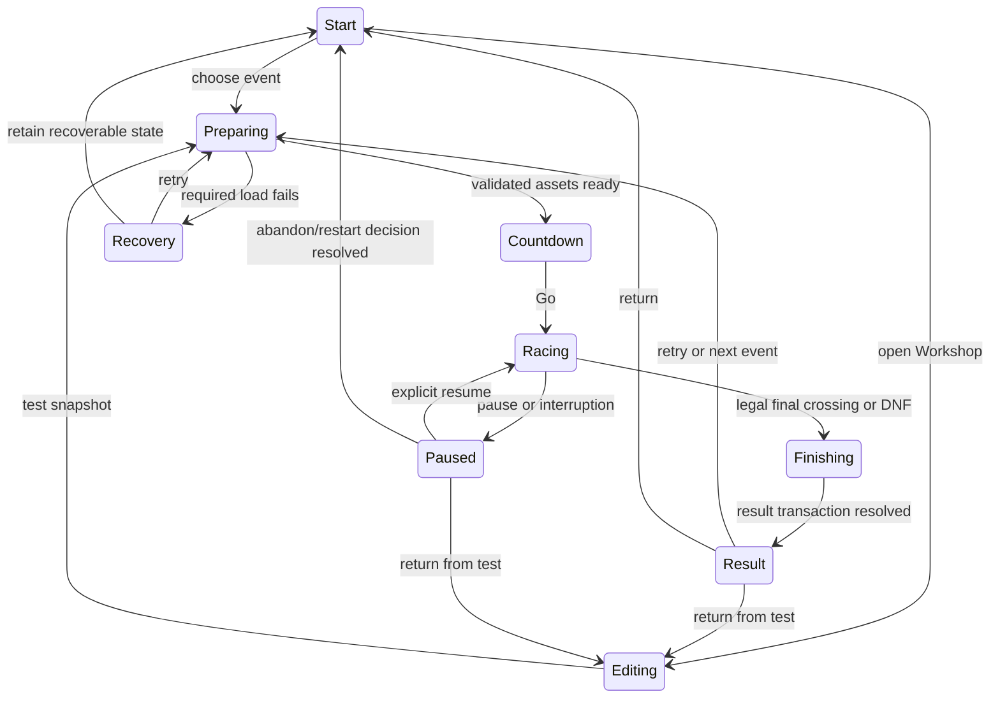

# Scrap League architecture

## Ownership and design boundary

Pagelove owns addressable published documents and validated application records. Authored track and part documents describe meaningful game content. A shared parser and compiler derive the runtime's arrays, geometry, AI route and editor view. Browser code owns simulation, rendering, input, local progress and working drafts.

This is a proposed architecture based on the project's documented platform findings, not a fresh claim of verified behavior on a new host. Follow the support-confirmed trusted WebDAV contract. Before depending on native routes, composition or a public score policy, verify the intended operation on the selected host with bounded controls.

## Resource map

| Resource or store | Authority and lifecycle | Consumers and mutations |
| --- | --- | --- |
| `content/catalog.html` in source | Reviewed official IDs, ordering, cup membership and references | Build, start screen, progression and release manifest; reviewed changes only |
| `content/tracks/{slug}/definition.html` in source | Official track metadata and complete owned geometry | Workshop authoring, compiler, release bundle; promoted from reviewed exports |
| `content/parts/{id}.html` in source | Part definitions and allowed behavior parameters | Garage, simulation, build hashing and help |
| `content/rivals.html` in source | Eight rival definitions and preferences | Seeded cup roster and AI controller |
| `content/cups/{id}.html` in source | Event order and references | Progression, cup standings and opening/ending copy |
| `content/daily/{scheduleRevision}.html` in source | Versioned schedule and resolved date contracts | Challenge creation and historical challenge links |
| `/workshop-tracks/{id}/definition.html` on host | Owner-managed mutable track, with stable identity and current revision | Public track detail, native editor composition, Workshop racing; conditional owner write |
| `/workshop-catalog.html` on host | Owner-managed discovery references | Workshop browsing; conditional index update after content publication |
| `/boards/{mode}.html` on host | Server-persisted casual run records and separately reviewed rules | Selector reads and bounded append through application route; never replaced by normal releases |
| `/editor/:slug`, `/track/:slug` | Native route templates and shared shell composition | Resolve bounded valid identities, include safe permitted fragments; no authority is granted by composition |
| `/releases/{releaseId}/...` | Immutable derived runtime assets and official bundle | Game, offline worker and pinned old clients; do not duplicate active schema/policy declarations here |
| IndexedDB stores | Progress, cup snapshot, presets, drafts, bests, ghosts, outbox, board cache | Atomic browser transactions with explicit schema migrations |
| In-memory state | Active run, input, compiler cache, meshes, audio and editor selection | Temporary; never treated as confirmed publication or durable queue state |

Official source files and hosted Workshop tracks have distinct ownership. Normal deployment must not overwrite `/workshop-tracks/`, the discovery catalog, or populated boards. Seeding uses create-only semantics. A reviewed Workshop track can be promoted into official source as an explicit release change, with an intentional gameplay revision.

## Structured content contract

Use a documented application vocabulary such as `urn:ScrapLeague:Track`, `:RoadPiece`, `:SurfacePatch`, `:Checkpoint`, `:Spawn`, `:Prop`, `:Part`, `:Build`, `:Cup` and `:Run`. Specializations include their base type and are matched with token-aware selectors. These names are application vocabulary, not invented built-in Pagelove APIs.

Each source document uses semantic headings, descriptions and lists/tables for its readable representation plus typed microdata for structured values. HTML parsing cannot establish reference integrity by itself. The shared schema module implements the required bounds and relationships, and the application write path enforces the relevant public-record constraints.

### Track schema 1

| Entity | Required fields | Relationships and rules |
| --- | --- | --- |
| Track | `id` UUID, `slug`, `schemaVersion=1`, `name` 1–60 chars, `description` 0–240 chars, `pieceCatalogRevision`, `laps` 1–9, `scenePreset`, `musicPreset`, owned collections | One start-straight, one finish, 3–32 checkpoints, six grid spawns; no unsupported properties silently dropped |
| RoadPiece | UUID, allowed `kind`, X/Z, heading, width or entry/exit width, allowed length/radius/turn, `nextPiece` | Successor exists in same track; every piece belongs to one directed closed loop; geometric constraints from Workshop |
| SurfacePatch | UUID, `pieceId`, surface enum, start/end distance, lateral min/max | Same-track piece exists; bounds fit its road; incompatible overlap rejected |
| Checkpoint/Finish | UUID, kind, `pieceId`, distance, `order`, forward normal | Exactly one finish; unique contiguous ordinary order; road-spanning finite gate, legal spacing |
| Spawn | UUID, role grid/respawn, X/Z, heading, grid slot or `gateId` | Unique grid slots 1–6; exactly one safe respawn per gate; current supported hull clearance |
| Prop | UUID, allowed base type, position, heading, bounded footprint, optional recipe ID | Collision/trigger shape matches visible solid geometry; recipe belongs to this document and supported catalog |
| Recipe | UUID, registered base capability, supported finite parameters | Maximum 16 recipes; no scripts, include directives, executable URLs or recursive recipes |

Track and its owned geometry live in one document so the compiler can validate a complete proposal. A separate catalog reference is discovery metadata and never establishes track validity. Parameters selecting runtime presets are enums from an immutable compatible catalog, not URLs for code execution.

Slugs match `[a-z0-9]+(?:-[a-z0-9]+)*` and are at most 48 characters. Published track identity is the UUID; the slug is presentation/routing metadata with an explicit alias on rename. Native editor routes resolve through a validated catalog rather than concatenate arbitrary user strings into an include path. Missing or unknown identities show a chooser and keep editing/publishing disabled until a valid source is selected.

### Parts, builds and cups

Part definitions include immutable ID, slot enum, schema version, display metadata, mass and only the physical/behavior fields belonging to that slot. A build has exactly one valid reference for each of four slots and a canonical part-definition snapshot for an active run. Catalog deletion of a referenced part is rejected until dependent official builds/daily definitions migrate; old release snapshots retain their original part definitions.

Cups reference exactly three existing event IDs and each event references one existing official track and its race rules. Official content is validated together during a clean build, including orphan references and mismatched types. A release cannot pass by consulting a previous generated bundle. Runtime loading pins the complete validated bundle, so subsequent source editing cannot create a check-then-use race inside that run.

## Revisions and derived representations

Compute a canonical gameplay representation containing geometry, surfaces, gates, spawn rules and recipe behavior, but excluding descriptive copy, lighting and audio. Hash it with SHA-256 as `trackGameplayRevision`. A separate full document revision detects authoring changes. Include the declared physics version, effect rules, race-timing/checkpoint logic, allowed part definitions and assistance semantics in `rulesRevision`. Declare physics-version changes deliberately; a source-file hash alone is not a policy for comparability.

`buildRevision` hashes the four part IDs and their complete effective physical definitions. Comparison key is mode + track gameplay revision + rules revision + build revision + laps + assistance profile + challenge identity when applicable. Visual quality, audio, camera mode and cosmetic paint do not affect the key. A result carries the actual key captured for that run.

The compiler produces road meshes, collision primitives, a spatial index, route arc-length samples, AI lookahead data, minimap paths and compact surface intervals. These are generated outputs with source revisions. The editor manipulates a typed working model with a lossless canonical HTML serializer; it is a view of the same contract rather than a second hand-maintained track format.

Ghosts are a deliberate specialized binary representation. Record vehicle pose, wheel/steer visualization and time at 20 Hz, with interpolation, maximum eight-minute duration and a 512 KiB per-ghost budget. Ghosts are non-colliding visual comparisons and never drive gameplay. They bind to the full comparison key, store with the associated best in one transaction and can be disabled. This avoids a promise of bit-identical replay across browsers and future engines. Input/event traces for diagnostics are separate bounded opt-in exports.

## Runtime modules and state

Use portable ES modules with a bundled, pinned Three.js renderer and Bun for local build, validation, preview and CI tooling. Select and verify exact library/toolchain versions during implementation; ship a lockfile and local runtime assets. No runtime CDN dependency is required. A small HTML/CSS application shell is sufficient; specialized simulation does not require a page framework.

| Module | Responsibility | Important boundary |
| --- | --- | --- |
| `model` | Inert parse, schema validation, canonical serialization, revisions | Same code path for official build, import, editor and runtime entry |
| `track-compiler` | Analytic piece geometry, corridor, collision/index, route and surface samples | No rendering or persistence side effects |
| `simulation` | Fixed-step car dynamics, collision, effects, checkpoints and deterministic RNG | Pure state transition per tick/input; no DOM queries or network calls |
| `race-session` | Mode contract, countdown, pause, finish, result identity and cup transaction | Owns clocks and input authority |
| `ai` | Route planning, passing, controls and recovery requests | Emits legal input; never sets position or grants progress |
| `renderer` | Camera, car/track scene, interpolation and bounded effects | Presentation quality cannot change physics |
| `audio` | Engine/surface/contact/music voices and lifecycle | Bounded voices; user gesture activation; suspend when inactive |
| `workshop` | Commands, selection, inspector, history and test snapshot | Uses shared model/compiler and real race session |
| `storage` | Versioned transactions, progress, drafts, bests and outbox leases | UI acknowledges committed state only |
| `pagelove` | Reads, validated public score appends, owner publish conflicts/readback | Explicitly separates application and authoring endpoints |
| `release-client` / worker | Inventory, release pinning, offline readiness and safe update | Mutable resources and non-GET/selector traffic bypass static cache |

Preparing owns an operation token; late asset, network or compiler results cannot start a race after the player navigates away. Async saves and submissions use their own identity and cancellation/reconciliation contracts. A dialog is a substate with a defined parent/focus return, not a boolean that permits racing behind it.

On each simulation step: consume bounded input; update effect availability; compute surfaces and forces; integrate with chronological collision resolution; detect ordered swept gate crossings; apply checkpoint charge once; resolve finish; record telemetry/ghost sample; emit completed facts. A finish freezes the result at the exact crossing fraction. Effects after that fraction cannot add time, charge or progress. Pause stops simulation time and clears input. Hidden-tab elapsed wall time never becomes a large catch-up simulation.

Use a bounded accumulator of at most eight physics steps per render opportunity; cap elapsed recovery to 100 ms. If the app cannot keep up, slow its simulated wall-time pacing rather than skip collision steps, flag the attempt as performance-degraded and offer reduced effects. A degraded solo attempt remains a local result but is not offered to the shared comparable board, because sustained time dilation can make control easier. Benchmark and communicate this only when the threshold persists for two seconds, not for an isolated frame.

## Behavior and event contract

User-authored definitions select reviewed registry capabilities. Registries use own-property checks, bounded numeric parameters and one ordered capability set per object. Callbacks are synchronous, cannot spawn arbitrary code and are disposed when the scene ends. Promise-returning gameplay callbacks are rejected in development and fail the capability safely in release.

| Event | Kind and timing | Cancellation, ordering and failure |
| --- | --- | --- |
| `resetrequested` | Request before moving a car to a checkpoint | Cancelable by session rules; one request per car/tick; failure leaves car unchanged |
| `boostrequested` | Request before consuming charge | Cancelable when mode/state/input rules forbid it; no charge consumed on rejection |
| `contactresolved` | Fact after a collision impulse | Not cancelable; includes participants, tick and impulse; audio/render listeners cannot change physics |
| `checkpointpassed` | Fact after legal gate acceptance | Not cancelable; unique car/lap/gate sequence key; repeat observation is ignored |
| `lapcompleted` | Fact after legal finish with remaining laps | Not cancelable; includes exact split and current comparison key |
| `racefinished` | Fact after final result snapshot | Once per run ID; progression/persistence uses idempotent transaction |
| `draftchanged` | Fact after a committed editor command | Carries draft revision; triggers debounced storage, not publication |
| `trackpublished` | Fact after matching server readback | Carries publication and draft snapshot revisions; newer edits remain Draft |

Gameplay registry order is base object, optional specialization, then one bounded recipe. Requests can stop later handlers on cancellation; completed-fact handlers cannot roll back committed simulation. Catch/report a failed optional observer without corrupting the run. Physics-capability failure pauses with recoverable diagnostics rather than continue silently with different rules. A maximum 64 generated gameplay events per car/tick and no recursive event dispatch prevent unbounded chains; exceeding a budget is a recoverable error, not a partial reward.

## Persistence and recovery

Use separate IndexedDB stores for settings, progression, cups, presets, track drafts, track snapshots, local results, bests, ghosts, outbox and cached boards. Version the database and each stored record independently. Validate restored records and references; preserve incompatible originals for download. Ordinary updates never clear stores as a cache repair shortcut.

For a successfully finished League round, the completion transaction writes the immutable result by run ID, marks that round complete, grants first-completion rewards once, updates applicable bests and retains the next cup checkpoint. A DNF writes attempt history only and keeps the cup at its prior checkpoint; it grants no rewards or comparable time. A successful solo result updates its compatible personal best and ghost atomically. On transaction failure, keep the result in memory, present Retry save and Download result, and do not claim it is saved. Submission is a separate optional transaction; personal progress never depends on the remote board.

The race-start snapshot captures track/parts/rules/seed so reloading a League round can restart it honestly under the same contract. It does not claim to save an exact mid-race position. Store checkpoints at preparation and committed result boundaries, not every animation frame or only on unload.

Draft saving uses complete snapshots and last-valid recovery as specified in the Workshop. Cross-tab editors detect a newer stored draft revision and offer opening a copy or reloading; they do not silently overwrite. The owner publishing flow adds remote ETag guards and semantic baseline comparison.

## Casual shared results

Runs are client-reported and server-constrained; this is a casual leaderboard. Geometry validation, UUIDs and hashes do not prove honest play. A separate verified competition or live multiplayer server is not assumed.

Required run fields: stable run UUID, alias (1–24 Unicode characters, normalized and control characters rejected), mode, track ID/revision, rules revision, build revision, assistance key, lap count, challenge ID/date when applicable, completed elapsed milliseconds, ordered lap splits and completion state. Server-owned receipt time and expiry cannot be supplied by the client. Time bounds are positive and at most 480,000 ms, splits are positive and sum to total time, and only recognized official content keys enter official boards. Workshop scores stay local in launch scope.

Apply native application authorization, schema/shape validation, request grammar and unique run identity to selector-scoped appends. Allow only the intended fields and operations. Read accepted record identity/content before acknowledging ambiguous or duplicate outcomes. Never use the owner's DAV key for public score entry. Render aliases with text APIs. Aliases are labels, not authenticated identities; duplicates are allowed and do not merge independent racers.

Rank compatible completed runs by elapsed milliseconds, then best lap, then server receipt time, then run UUID. A millisecond tie remains visibly a tie on the principal time even when display order is deterministic. Read the top 25 through a bounded query/pagination strategy verified on the actual host. A failed fetch preserves the last successful board with its refresh status and never displays “No times yet.”

The proposed retention contract follows the accepted previous-game pattern: eligible for five days after server receipt, filtered on reads/display, with physical cleanup on later online access. No unattended deletion deadline is promised. The cleanup authorization permits only server-expired records. Keep this policy visible near the board. Test exact boundaries and interleaved active controls; inspect physical storage through a non-triggering path when proving deletion.

Offer improved valid Time Trial/Daily results for submission; do not automatically send every practice run. Commit the pending record before showing Queued. Maximum pending outbox is 100 entries; on reaching it, offer export or explicit review rather than silently evicting results. Two tabs use an atomic claim with a random lease token and 30-second expiration; responses acknowledge only the matching token and run contents. Retry transient failures with jittered backoff up to five minutes. Permanent rejections remain recoverable with a reason. An ambiguous success reconciles the original run ID, never generates a new one.

Public-policy source publication is distinct from effective enforcement. The previous project recorded stale-policy windows and intermittent processor errors. Establish the new game's initial application route through the provider-supported activation procedure before enabling submission, with positive/negative and duplicate controls. If the provider cannot supply adequate activation guarantees, keep online submission disabled and retain local results while resolving that deployment requirement. Warm-up reads or a fixed sleep are not proof of global readiness. Routine subsequent releases preserve established policies.

## Daily time and history

Use UTC for challenge identity, and state the timezone in friendly UI dates. Store the resolved daily definition and original date with each attempt/outbox item. Refresh the current challenge on startup, focus, foreground and reconnection as well as a timer. Crossing midnight never changes an active attempt or queued record.

Historical links resolve an available immutable challenge snapshot. If the requested date is unavailable, state that and offer the current challenge; never label today's rules as the historical event. A server Date header may improve display-clock estimates but does not establish anti-cheat or perfect synchronization. Each complete release includes 90 upcoming UTC dates and 30 preceding dates for its schedule revision. Offline play uses this downloaded schedule; if the requested date is outside it, offer ordinary Time Trial.

Challenge identity is schedule revision plus UTC date, with resolved track/build/rules snapshots. A later schedule may become current at a declared UTC boundary while an offline older release retains its downloaded edition. Show “Downloaded edition” until current schedule identity can be checked. On reconnect, an older-edition result remains associated with that exact historical challenge and is never submitted as the current edition. Keep the historical rules/assets needed to play a shared challenge, or explain that it is unavailable. This avoids pretending an offline client knows about an unseen rules change.

## Performance and content budgets

These are acceptance targets, not measurements. Baseline is a mid-range Android device with 6 GB RAM and a supported browser plus a typical integrated-GPU laptop; record the actual hardware when testing.

| Area | Initial budget or target | Measurement |
| --- | --- | --- |
| First playable download | ≤5 MiB compressed critical path; ≤15 MiB complete offline pack | Build inventory and cold network profile |
| Startup | Ready within 5 s on 10 Mbps / 80 ms RTT after connection; subsequent menu within 1 s | Cold and warm traces, including parser/compile/warmup |
| Racing | Target 60 FPS; p95 frame ≤20 ms, p99 ≤33 ms on baseline at default quality | Full race including first collision/pad and six cars |
| Input response | Input reflected by next simulation step; visual response target ≤50 ms | Instrumented event-to-frame and real-device observation |
| GPU | ≤200 draw calls, ≤200k visible triangles, DPR cap 1.5 default on mobile | GPU/frame inspection, all scenes/effects |
| Memory | Working set target ≤200 MiB where measurable; no monotonic growth after 20 race/editor cycles | Browser/platform tools with exact limitations recorded |
| Editor | Common placement/undo feedback ≤50 ms; full max-track validation ≤250 ms off main path when necessary | Typical and worst bounded fixtures |
| Assets/effects | Particle pools capped at 256; simultaneous audio voices ≤24 | Stress race and long-session counters |

Prepare representative car parts, surface shaders, effects and audio paths before Go. Reuse bounded pools and dispose obsolete meshes/materials/targets. Graphics-context loss pauses simulation and input, rebuilds resources, warms them and requires explicit resume. The startup fallback is independent of the main module import and offers a functioning Retry/Reload path.

## Offline, installation and updates

Build a manifest of every required immutable runtime asset with integrity hashes. The official track bundle, car parts and Workshop tools belong in the complete offline set. A worker verifies actual entries before declaring readiness. Keep published-track snapshots and local drafts separate from static code caches; a current mutable read must not be served as if it were a confirmed fresh publication. The bundled app's Workshop chooser opens local drafts and imports offline; a native `/editor/:slug` composition remains a network operation and falls back to that chooser with an explicit cached-source choice when available.

Pin each open client to a complete release. Download and validate a candidate, show Update game where a phone user can see it, then activate only at a safe start screen after a second state/readiness check. No update during racing, test drive, publication or unsaved editor work. Preserve progress, drafts and outbox. A late timed-out update response must not reload unexpectedly. Failures retain the old complete release and offer retry.

Test natural A-to-B discovery, multiple tabs, worker restart, interrupted downloads, cache eviction, storage failure, offline activation of a complete candidate and genuine cold relaunch with the server unavailable. “Installed,” “Ready offline,” and “Online times synchronized” are separate states.

Use a manifest with requested fullscreen display and fallbacks, regular and maskable icons, and a gesture-based fullscreen control when supported. Native fullscreen state, installed window mode and CSS viewport usage are separate observations. Respect exit and preserve usable safe-area layouts. Do not promise an OS bar disappears without device evidence or recommend clearing player storage as a first repair.

## Release procedure

1. Record plan and source identity. Build all derived content from authoritative documents with prior output absent. Run schema, geometry, physics, progression, storage, browser and release checks appropriate to the change.
2. Keep reviewed source, generated package and live mutable data separate. Produce hashes and a scoped diff including new files. Required hosted CI must validate the exact revision and prevent a deliberately failed fixture from passing the gate.
3. Stage immutable runtime dependencies, verify their public bytes/semantics, then conditionally promote entry points. Keep old packages needed by active clients. Root multi-file publication is not assumed atomic.
4. Preserve Workshop documents, discovery index, boards and established policies. New policy activation or schema migration is a separate deliberate operation with provider evidence and recovery.
5. Read back the public release, all required assets, native editor routes and owner publication path. Verify semantic HTML normalization precisely; do not ignore script/URL differences.
6. Exercise an actual older client discovering and applying the update, confirming retained progress, drafts and pending results. Record rollback package and promotion procedure.
7. Report local, committed, pushed, merged, deployed and verified status separately. This design task itself performs none of those release operations.

## Significant decisions and exceptions

Planar physics permits clear readable collision, stable mobile controls and an editor whose topology can be fully validated. Elevated 3D rendering supplies the diorama presentation. Dense route arrays, meshes, audio buffers, ghost recordings and browser storage records are justified specialized representations; the durable published content remains inspectable HTML with traceable revisions.

A track owns its dependent geometry to keep structural validation coherent. Immutable official snapshots protect ongoing events. Mutable Workshop publication uses owner trust and conditional writes. Shared casual times use the distinct application boundary. No external server is introduced merely to exercise a feature, and no real-time transport or anti-cheat service is implied by Pagelove document persistence.
