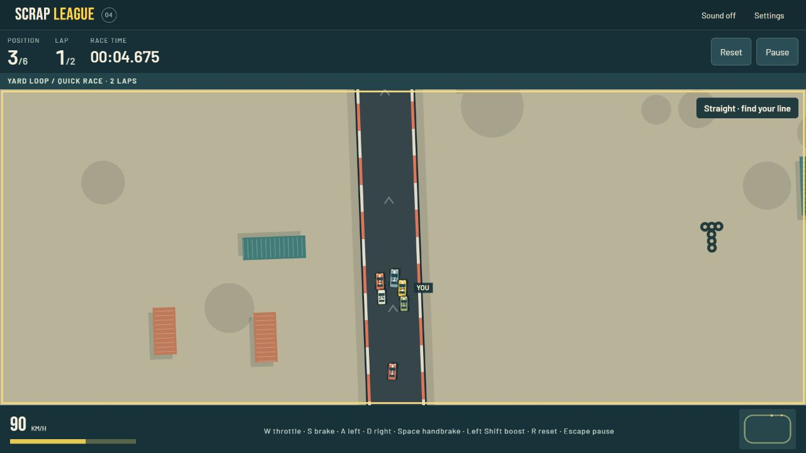

# Scrap League audit against handbook 2.10.0

The guide caught real game and process defects. Local repairs and qualified regressions are complete for the fixed findings below; full product acceptance remains open. This is an audit of the current Demos checkout, not the older Pagelove workspace copy.

Candidate sl-b63afc9cbb2339; source 9e10a98cb441eb3e4153f4e85911bb5c407a2dff5c15c38c3ae4a6d593d93a59; output 8bcdf0696e1bfcfd57e5f824df7a11095e2059fc799ac147f796f3cb81372e0c; inventory d01e1dafd0d194be73bc803c6a2677fa030d5126a962760c5e8f43d86e5dae60.

The guide snapshot is pinned in requirements.json; the source was initially clean at 861d3af. The public site still serves sl-8c38d2602f174d. No commit, push, deployment or public-data write was performed.

## Findings and controls

| Finding | Mechanism | Status | Inventory | Concrete control or next action |
| --- | --- | --- | --- | --- |
| F01 | Missing required stylesheet still reported ready | Fixed | C12 | Bootstrap independently verifies core/arcade style contracts and shows inline reload recovery; raw red CSS fixture retained. |
| F02 | Generic instruction plus agent receipt bypassed required outcomes | Fixed | C05/C13 | Shared strict status gate runs before considering an operation receipt; red refusal regression retained. |
| F03 | Guide and acceptance decisions were not pinned to an exact inventory/review | Fixed | C11 | Guide snapshot/digest, inventory hash and candidate-bound review artifacts are verified; stale-decision refusal fixtures retained. |
| F04 | Tests replaced historical evidence files | Fixed | C09/C10 | Recovered tracked originals, retained fresh details and changed writers to content-addressed immutable observations. |
| F05 | Fixture did not qualify current dialog/document readiness | Fixed in verification | C09/J09 | Wait for the actual open recovery state and document-bound inspection handle; rerun affected journeys. A stale-module return was a hypothesis, not an independently established cause. |
| F06 | Paused accelerated run counted as completed; malformed result made a save unreadable | Fixed | P02/J03/J04 | Strict complete-lap oracle, guarded finish and pre-transaction result/prior/next-state validation. Independent red atomic-write regression retained. |
| F07 | Broad passed labels exceeded demonstrated input/reload scope | Claims corrected; coverage open | J02/J08/M02/M04 | Explicitly reopen missing subcases; no form or component check substitutes for every input/zoom/process journey. |
| F08 | Publisher lacks durable phase journal and supported-command recovery proof | Open | C05/C08/C14 | Implement per-entry rechecks, phase persistence and controlled supported-command success/failure/ambiguous recovery. |
| F09 | Provider, process restart, provenance and current hosted/live limits remain | Open | P01/P05/P08/J13/M03/M05/M06/C04/C06 | Keep exact limitations; no unsupported guarantee or silent waiver. |

## Executed evidence

- Complete automated suite: 115 passed, zero failures; exact raw log closing-tests.txt. Final focused gate/data/evidence regressions: final-controls-tests.txt. Red-before-fix logs and failed browser receipts remain.
- Current release has 19 distinct passing named browser observations at this review; see [the evidence review](evidence-review.md) and [generated index](browser-index.json) for exact names, identities and limits. Accelerated controllers use legal physics and require all laps; they do not measure enjoyment or natural pacing.
- Actual connector keyboard actions started/drove/paused/opened Settings/resumed an uninstrumented copy. A fresh document recovered its saved draft and drove while the server returned ECONNREFUSED. These observations were on the preceding repair graph and are reused only for unchanged input/offline/style behavior; they do not prove process restart or the newly hardened result transaction. See ordinary/offline AX files and screenshot below.
- Public HTTP reads verified the prior release's styles, favicon/touch icon, OG image, composed circuit routes and both leaderboard resources; all returned 200 with matching immutable asset hashes. This is read availability, not new mutation enforcement. See live-readback.json.
- The earlier full-quality race recorded 16.8 ms p95 / 16.9 ms p99 over 3,003 frames with zero hidden time, six cars, full effects and a 1920×753 buffer. That scope is separate from the earlier twenty-minute lower-resolution soak; neither is relabeled as a new final-candidate soak.

## Remaining acceptance work

- **J02 (partial)**: Current pause/settings/resume, synthetic device ownership and connector key activation are evidenced. A complete sequential keyboard/touch interaction matrix is not inferred from selected activation checks.
- **J08 (partial)**: Form/list authoring, validation and legal laps are tested. Complete pointer and emulated-touch creator workflows remain unverified; a form-route pass does not satisfy those subcases.
- **J13 (blocked)**: Fresh-document offline load, draft recovery and real keyboard driving were observed with server connection refused. Actual browser-process cold relaunch is not exposed by the current connector.
- **P01 (partial)**: Atomic quota/conflict/abort/reopen and current closed-store export tests pass. Complete process-crash before/after commit evidence remains unavailable.
- **P05 (partial)**: Local policy/shape/split/idempotency tests pass. Prior public mutation probes retain intermittent provider failures; this audit performed read-only live checks and does not claim a new complete production mutation matrix.
- **P08 (blocked)**: No supported provider-wide policy-readiness procedure is available. Current successful board reads do not replace it or waive the requirement.
- **M02 (partial)**: New-track form commands, five-AI test/return, history and export are exercised. Complete creator journeys across all promised input paths remain open.
- **M03 (partial)**: All 81 builds, all circuits and continuous seeded campaigns are covered. Original circuits were CLI-authored; later editing cannot retroactively establish original UI-authoring provenance.
- **M04 (blocked)**: Current worker contracts and fresh-document offline paths have evidence; actual browser-process relaunch and the complete supported input/zoom matrix remain unresolved.
- **M05 (partial)**: Unchanged owner/publication/retention/outbox endpoint evidence is reused within its original limits. Current HTTP reads pass. Unsupported global readiness and prior intermittent mutation failures remain unresolved.
- **M06 (blocked)**: The current candidate is local and not fully accepted. Outstanding input/process/provider/publishing outcomes prevent a full release claim. No commit, push or deployment occurred.
- **C04 (partial)**: Local workflow/gate source and refusal tests are inspected. Hosted CI/required-rule evidence is historical; the changed source has not been committed or run in hosted CI.
- **C05 (partial)**: Shared strict gate now refuses unresolved outcomes on both publisher paths and binds guide/inventory/reviews. Per-entry rechecks during a multi-entry promotion and more granular required-scenario receipts remain open; no complete publisher enforcement claim.
- **C06 (not-run)**: Live readback verifies the previous published release and its required style/icon/share/route/board paths. The repaired local candidate has not been published.
- **C08 (partial)**: Conditional root-restoration and stale/tampered baseline helper fixtures pass. Actual supported-command post-write/ambiguous recovery and multi-entry journal coverage remain unverified.
- **C14 (failed)**: Source inspection finds a final deployment receipt rather than a durable per-phase promotion journal. Supported-command post-write and ambiguous recovery proof is missing. Implement those controls and recheck before publication.

The required physical/human exclusions remain. Available browser emulation does not certify an unavailable engine or the reported physical phone. A finite verification run cannot establish absence of every possible defect. Full acceptance and promotion remain refused while adopted required outcomes are unresolved.

## Review and reproduction

[Coverage review](coverage-review.md), [evidence review](evidence-review.md), [reuse decision](reuse.json) and [append-only audit](audit.md) retain authority and limitations. Runtime code is free of the local inspection hook; only the loopback review servers append it. Run node tools/build.mjs, node --test tests/*.test.mjs and the scoped browser-server.mjs; use its explicit controls for browser journeys. The release gate is expected to refuse this incomplete candidate.
