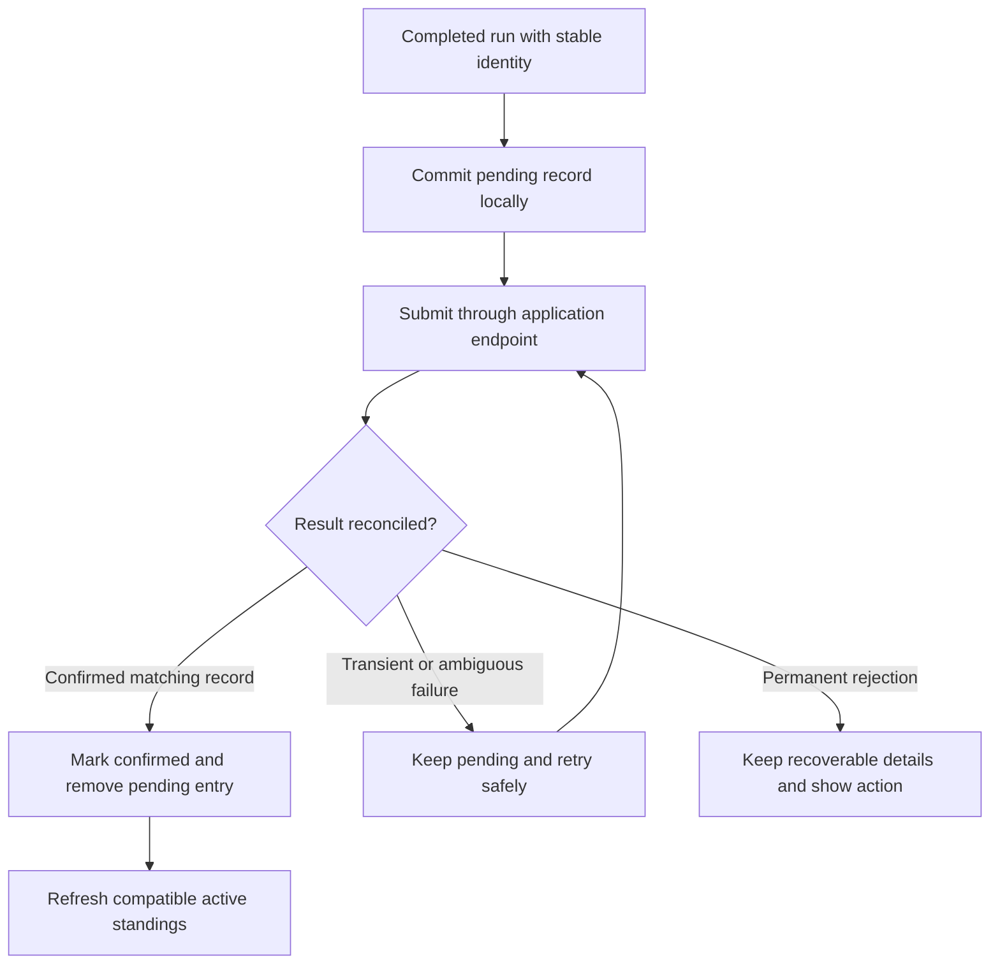
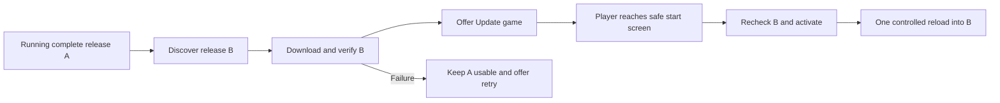

# Building durable, engaging games on Pagelove

## Purpose and authority

This is a reusable development handbook distilled from Prism Breaker's creation, user feedback, defect investigations, audit trail and release work through **October 15, 2026**. Use it for action games, puzzles, strategy games, narrative experiences and other interactive projects. The examples are concrete; their particular speeds, score values and content limits are not universal defaults.

**Governing rule:** Prefer document-first, extensible web development. Make durable subject matter inspectable, independently addressable and editable. Derive efficient runtime representations from those documents. Give behavior explicit contracts, enforce authority at the appropriate write boundary, and require evidence that the complete player experience works.

This handbook is a **strict content superset** of the exact `C:\Users\Wesley\Documents\Codex\Pagelove\DOCUMENT-FIRST-DEVELOPMENT.md` supplied by Wesley. Appendix A preserves that entire document verbatim, including its relational-integrity requirements and standing instruction. The crosswalk connects all 23 rules to the additional guidance here. The appendix is normative, not optional background.

Three kinds of statements are deliberately distinguished:

- **Project evidence:** behavior established in Prism Breaker source or dated records. An old result describes that source and environment, not every future release.
- **Recommended practice:** a reusable approach, acceptance criterion or improvement for a future project. Its presence here does not mean every item is implemented in Prism Breaker.
- **Open acceptance or platform question:** something that still requires hardware, people or a provider contract. It must not be reported as a completed check.

The available conversation supplies the requests and decisions. Repository reports and audit records supply recorded outcomes; earlier assistant responses and unrecorded sessions are not completely available. Some early notes are retrospective. The source inventory records the available corpus, not a claim that every screenshot, raw response and historical patch was independently replayed.

## Contents

1. [Start with the player and the contract](#1-start-with-the-player-and-the-contract)
2. [Design the document model](#2-design-the-document-model)
3. [Use Pagelove deliberately](#3-use-pagelove-deliberately)
4. [Build safe extensibility and editors](#4-build-safe-extensibility-and-editors)
5. [Model state, input and simulation](#5-model-state-input-and-simulation)
6. [Make the game engaging](#6-make-the-game-engaging)
7. [Balance progression with evidence](#7-balance-progression-with-evidence)
8. [Make scoring understandable and fair](#8-make-scoring-understandable-and-fair)
9. [Specify power-up interactions](#9-specify-power-up-interactions)
10. [Build a dependable leaderboard](#10-build-a-dependable-leaderboard)
11. [Handle daily challenges and expiry](#11-handle-daily-challenges-and-expiry)
12. [Design for every screen and input](#12-design-for-every-screen-and-input)
13. [Make accessibility part of the game](#13-make-accessibility-part-of-the-game)
14. [Direct cinematics and audio](#14-direct-cinematics-and-audio)
15. [Budget performance and recovery](#15-budget-performance-and-recovery)
16. [Create a coherent brand, favicon and social artwork](#16-create-a-coherent-brand-favicon-and-social-artwork)
17. [Make sharing useful on each platform](#17-make-sharing-useful-on-each-platform)
18. [Engineer offline play and safe updates](#18-engineer-offline-play-and-safe-updates)
19. [Treat installation and fullscreen as separate capabilities](#19-treat-installation-and-fullscreen-as-separate-capabilities)
20. [Release without losing data or mixing versions](#20-release-without-losing-data-or-mixing-versions)
21. [Review complete journeys and independent invariants](#21-review-complete-journeys-and-independent-invariants)
22. [Diagnose incidents and preserve learning](#22-diagnose-incidents-and-preserve-learning)
23. [Adapt the approach to other genres](#23-adapt-the-approach-to-other-genres)
24. [Reusable project and release templates](#24-reusable-project-and-release-templates)
25. [Lessons, corrections and unresolved acceptance](#25-lessons-corrections-and-unresolved-acceptance)
26. [Document-first coverage and source map](#26-document-first-coverage-and-source-map)
27. [Appendix A: complete governing document](#appendix-a-complete-governing-document)

## 1. Start with the player and the contract

Write the game's promise before selecting an engine: what the player does, why it is satisfying, how a session ends, how long it should last, and what brings someone back. Define the audience's likely device, input method, familiarity and accessibility needs. A polished rendering cannot compensate for an unclear objective or an unreliable control.

Separate the immediate loop from progression. In Prism Breaker the immediate loop is aim, hit, react and catch; progression is restoring themed worlds; replay comes from improving a score and attempting the daily challenge. A puzzle might instead use observe, infer, act and verify, with progression through new constraints. Each layer needs its own feedback and success criteria.

Make a short contract for each mode:

| Decision | Questions to answer before implementation |
| --- | --- |
| Entry and exit | New game, resume, retry, abandon, return to start screen: what happens to progress? |
| Rules | What counts as winning, losing, a valid move, a pause and a completed run? |
| Fairness | Does everyone use the same content, seed, assistance and ruleset? |
| Persistence | What survives reload, an update, device sleep or offline use? |
| Connectivity | Which experiences remain useful without the network? |
| Presentation | What happens with reduced motion, muted audio and small screens? |
| Acceptance | What evidence will demonstrate each promise? Which checks require a person or phone? |

Convert ambiguous requests into observable outcomes. “Cinematic” becomes a directed sequence, deliberate framing, readable story text, appropriate music and usable continuation. “Offline” becomes cold relaunch after the network disappears, complete content, preserved progress and honest pending-score behavior. “Fullscreen” becomes explicit installed display mode, native fullscreen state and usable fallback geometry.

Keep an acceptance ledger from the beginning. A requested new feature is not automatically evidence that the previous version was defective. A repeated violation of an already accepted rule is a regression. Record that distinction so a retrospective fixes causes instead of rewriting history.

## 2. Design the document model

### Put durable meaning in durable resources

Identify the entities before their screens: worlds, rooms, questions, cards, units, dialogue nodes, challenges, recipes, runs and scores. For each, document identity, owner, schema, relationships, lifecycle, version and permitted mutations.

Use semantic HTML resources where they are a good fit. Prism Breaker moved from game definitions embedded in code toward a catalog and independently addressable world documents at `/worlds/<slug>/definition.html`. Nested microdata describes formations, rows, bricks, barriers, portals and custom types. The editor, preview, documentation and runtime can then interpret the same subject matter.

An illustrative fragment—not a complete Prism Breaker schema—might look like:

```html
<section id="world" itemscope itemtype="urn:World">
  <meta itemprop="id" content="world-garden">
  <h1 itemprop="name">Prism Garden</h1>
  <div id="row-0" itemprop="row" itemscope itemtype="urn:Row">
    <meta itemprop="y" content="9">
  </div>
  <div id="brick-17" itemprop="brick" itemscope
       itemtype="urn:Brick urn:Brick:Armor">
    <meta itemprop="row" content="row-0">
    <meta itemprop="hitpoints" content="3">
  </div>
</section>
```

The vocabulary must have a documented meaning; writing `itemscope` does not itself validate references, grant permissions or create an editor. Include the base type with specializations and use token-aware CSS selectors such as `[itemtype~="urn:Brick:Armor"]`. Avoid exact-string matching that breaks when a second type is added.

### Separate authority from useful copies

| Representation | Purpose | Authority |
| --- | --- | --- |
| Authored world HTML | Editing, review, composition, import/export | Authoritative content |
| Parsed validated model | Shared editor/runtime interpretation | Derived from a specified document revision |
| Three.js meshes and simulation arrays | Fast rendering and gameplay | Temporary runtime state |
| Generated offline world bundle | Reproducible complete play without the server | Derived release snapshot |
| Checkpoint | Resume one particular run | Durable player state, bound to content/rules revisions |
| Leaderboard resource | Shared submitted results | Server-persisted records within the chosen trust model |

Parse and validate at boundaries. Build efficient arrays, maps and GPU buffers once; do not query the document for every physics step. Document-first development does not require DOM-based physics or HTML storage for a particle buffer.

A clean build must regenerate derived files from authoritative sources with the old output absent. If a world is missing, fail with its identity and path. Reconstructing it silently from yesterday's bundle creates competing authorities and conceals content loss.

Separate permanent identity from display order, route slug and revision. A ninth world must not shift every later saved identity. Use stable IDs, explicit ordering and migration maps. Keep entity-ID allocators monotonic or otherwise collision-safe across delete, undo, import and save.

### Enforce relationships, not just field types

A valid integer `row` or well-formed ID does not prove its target exists. Check reference existence, target type, ownership, uniqueness and cardinality. A portal pair must actually have two compatible endpoints; a custom brick type must exist; a deleted row must not leave orphaned bricks.

Choose deletion behavior explicitly: reject while referenced, move dependents to a selected valid parent, or delete dependents together. Revalidate the final proposed document. Across multiple resources, identify the atomicity or concurrency mechanism; a successful lookup followed by an unrelated write is vulnerable to intervening changes. If the platform cannot guarantee the invariant, reshape the document boundary or narrow the operation rather than claiming relational integrity from markup alone.

## 3. Use Pagelove deliberately

Pagelove is useful here because the application can work with persistent HTML resources, native composition, request rules and authoring tools. The goal is to give those capabilities meaningful jobs, not to maximize a feature count.

| Capability used in Prism Breaker | Game use | Boundary to preserve |
| --- | --- | --- |
| Same-origin hosting | Engine, assets, fonts, icons, music code and game shell | No runtime CDN dependency is required |
| HTML microdata resources | World definitions and score records | Semantics are authored; enforcement needs actual rules |
| Selector-based reads | Fetch the leaderboard's `#scores` fragment | Check partial-response handling and stale/error behavior |
| Selector-scoped POST | Append one run to the shared score collection | Validate the submitted shape and reject duplicate identities |
| Schemas and request authorization | Bound score fields and allowed operations | Validation is not proof that the player honestly earned a score |
| Server-side processing | Assign expiry and perform access-driven cleanup | Processing on a request is not an unattended scheduler |
| Parameterized routing | `/editor/:worldname` | Validate the parameter before constructing resource references |
| Native composition | Editor shell plus the selected world's document | Retain source identity and write authority for composed content |
| Owner WebDAV authoring | Publish documents and application files | Trusted authoring; explicitly not the application validation path |
| ETags and conditional writes | Detect concurrent editing/publication | Readback confirms stored content; it does not prove policy activation |

The editor implementation verified the host's route parameter access and generated a native `p:include` for one allowed world. Earlier experiments with interpolated include resources and guessed selector/runtime APIs failed. Use a minimal positive control on the actual supported host before designing around an API assumption. Prefer documented native composition when it works; preserve a bounded fallback when it does not.

**Support clarification, October 15:** Wesley relayed that WebDAV intentionally bypasses all schema validation and triggers because it is an authoring mechanism. This resolves the original DAV bypass report as expected behavior. Client/build validation, ETag preconditions and readback remain valuable, but they are not a server enforcement boundary against a trusted owner writing different bytes. This is the explicit authoring exception to Appendix A's persistence-boundary rule. Untrusted application mutations still need their own supported authorization and validation path.

The project deliberately keeps owner DAV publishing and a casual leaderboard. It has not added a new public world-write grant, an authenticated application publishing service or verified-run competition. These are product choices, not forgotten tasks. See [the architecture](DOCUMENT-FIRST-ARCHITECTURE.md), [editor](WORLD-EDITOR.md) and [resolved support report](DAV-TRIGGER-BUG-REPORT.md).

Keep platform evidence precise. Stored policy text, a new ETag and an OPTIONS response are not proof that every serving worker has adopted a new rule. Source publication and effective enforcement are separate states. The current safe release path preserves established score policies; policy changes remain a separate controlled operation pending a supported activation contract.

## 4. Build safe extensibility and editors

### Extend through contracts

Use a small reviewed behavior registry and typed, bounded configuration. For example, a custom brick recipe can award points, damage neighbors, open gates, slow a ball or drop a known power-up. It should not supply arbitrary JavaScript, import a remote script or execute an expression from a document.

Specify event semantics before allowing extensions. Prism Breaker's model distinguishes a cancelable `strike` request before default damage from `brickdamage` and `brickbreak` facts after state changes. Document ordering, synchronous versus asynchronous handling, bubbling, cancellation, errors, repeated delivery and listener disposal. A listener removing itself must not remove another extension's listener. Use the target document's event constructor when crossing DOM realms.

A plugin that changes movement must coexist predictably with armor and a custom recipe. Decide precedence and bounded work. Protect against recursive damage storms, unbounded spawning and numeric overflow. Reject unknown executable capabilities. Preserve unknown data only under a deliberate forward-compatibility policy; otherwise reject it clearly. Silently accepting then dropping unsupported properties caused a real round-trip integrity defect.

Use own-property checks for registries. Validate finite values, permitted types, limits and spatial bounds—including the whole travel path of moving objects, not merely their initial position. Prototype names must not become behavior names by accident.

### Make editing use the real model

An editor should load, validate, preview and serialize the same document consumed by the game. A separate editor-only JSON structure tends to drift. Provide selection, visible validity feedback, undo/redo, draft recovery and export before complex collaborative features.

Distinguish states in both implementation and UI: draft, saving, saved, conflict, rejected and offline. A local draft is recoverable work; it is not a published world. Import into an inert parser, extract permitted semantic fields, validate, then reconstruct canonical safe markup. Do not insert imported HTML directly into the active application.

For owner publishing, obtain the current ETag and use `If-Match`; use `If-None-Match: *` for creation. Handle a conflict by retaining the draft and offering reload/compare/export. Do not automatically overwrite the changed source. Read back and compare meaningful content before reporting success. Pin the expected authoring host and keep the owner credential out of saved drafts, browser persistence, generated files, screenshots and logs.

Keep editing separate from ranked fairness. In this project Practice can use published edited worlds, while Adventure and Daily Challenge use the official immutable release snapshot. A future game can allow user-created ranked content, but it then needs explicit content identity, moderation and comparison rules.

## 5. Model state, input and simulation

### Use explicit transitions

Represent start screen, preparing, ready to launch, playing, paused, cinematic, result, submitting and error/recovery as meaningful states. Define which actions are allowed in each. Avoid a collection of loosely related booleans that permits playing behind a dialog or reloading during a score write.

For each transition specify input ownership, clocks, audio, focus, persistence and asynchronous cancellation. For example, pause must stop scoring time and simulation, clear held input, suspend the appropriate audio and move focus. Resume must restore the arena's input context. Closing a nested settings dialog should return to its parent; closing the final pause dialog should restore gameplay.

Seed randomness when reproducibility or fairness matters. Save generator progress with checkpoints. Separate gameplay randomness from decorative particle randomness so changing a sparkle count does not change tomorrow's challenge. Small launch variation can improve interest while preserving readable control: Prism Breaker uses 8–18 degrees to either side of vertical for fresh launches, with a deterministic sequence for a run. Sticky catches preserve their contact/rebound semantics instead of being treated as fresh launches.

### Make checkpoints a versioned contract

Save the information needed to reproduce the promised continuation: permanent world identity, content revision, ruleset, formation/phase, score, resources, active-time accounting and random-sequence position. Store or reference an immutable complete definition, including less obvious features such as portals. A checkpoint that silently substitutes a newly edited layout can change difficulty halfway through a run.

Decide whether resume restores an exact instant or a safe ready-to-launch state. Either can be reasonable; the UI and scoring must agree. Validate restored values and relationships before using them. A malformed or incompatible save should remain recoverable for export or diagnosis while the player is offered a new run; do not silently erase it merely because migration failed.

Version the save format separately from the application release. Migrate compatible old identities explicitly. Store essential progress at safe milestones and lifecycle opportunities rather than relying only on an unload handler, which may not run when a phone terminates the app. Use atomic replacement or transactions as appropriate, and retain the last valid checkpoint if a new write fails. Avoid continuous synchronous storage writes in the frame loop.

Preferences, personal best, a campaign checkpoint and a pending shared score have different lifecycles. Resetting one should not accidentally delete the others. The ruleset fingerprint in this project includes content and an explicitly declared physics revision; it is not an automatic hash of every engine behavior. Updating that declaration requires an intentional fairness decision.

### Make collisions follow the visible solid objects

Use a fixed simulation step, independently scheduled rendering and a bounded accumulator. Prism Breaker uses 120 Hz physics; that is a project choice. Clamp recovery after a long hidden-tab pause rather than simulating minutes of missed gameplay. Use elapsed simulation time for rules and intentional clocks for UI.

Fast balls and moving paddles require continuous relative-motion collision checks. Resolve the earliest collision, consume that part of the step, then process the remaining motion with bounded iterations. A wall rebound followed by paddle contact is a two-segment path; clamping the ball to the wall loses distance and can miss the second collision. Test chronological paths and corner cases, not just one straight sweep.

Define the physical surface from the visible solid body. Decorative glow can be excluded, but raised endcaps cannot silently be non-solid. Prefer a shared geometry descriptor used by rendering and physics, plus an independent geometric check. The previous rule rejecting every descending ball below the paddle center was wrong when the ball still overlapped its lower solid half. Tests that copied that rule initially passed the defect.

For every collision fix, include valid hits and genuine misses. Prevent a remedy from rescuing a ball that is completely below the paddle or bouncing a departing ball repeatedly. Cover stationary/moving objects, edge grazing, initial overlap, maximum speed, wide/normal sizes, multiple balls and collisions after reflections. Record seeds and a replayable failure trajectory.

Map pointer coordinates through the actual arena rectangle and camera, not the whole window. Recompute on resize and rotation. Capture active drag pointers, handle cancellation, and restrict touch-scroll suppression to gameplay. Keyboard shortcuts must not intercept name entry or editor fields. Focus behavior is part of the control system, not a cosmetic accessibility detail.

## 6. Make the game engaging

Build a recognizable identity with a small number of consistent choices: title lettering, geometry, palette, motion and sound. Prism Breaker's poster, stacked wordmark, crystal bricks and paddle eventually became one coherent visual language. A classic visual option can be useful, but it must retain the same collision geometry, legibility and rules unless advertised as a different mode.

Give every action useful feedback. A hit needs an immediate response; a surviving armored brick needs visible damage; a collected power-up needs a named effect and duration; a lost life needs a clear recovery state. Combine motion, sound and readable status so no essential fact depends on a single channel.

Prioritize information by what the player is doing. During play, their current score and lives deserve prominence. The leader's name and score provide a target without displacing the player's achievement. At the start screen, a daily challenge deserves equal visual weight if it is an equally important mode. Resume should be easy to find when a checkpoint exists. A long always-visible journey panel consumed arena space without helping the next action; the Worlds chooser is a better home for detailed progress.

Use contextual teaching. Explain aiming where the ball launches, show brick symbols in How to play, introduce a mechanic in a safe arrangement, and let the next world practice it. State that a count is remaining hits, not an arbitrary decoration. Match the help examples to both current and classic appearances.

Reward mastery and completion differently. A normal world completion, daily finish, Adventure victory and top daily score should feel distinct. Celebrate the accomplishment that actually happened. A failed record lookup should not hide ordinary completion. A tie or tentative lead should not be presented as an independently verified world record.

Make repetition comfortable: quick retry, skippable or manually advanced stories, remembered settings, no surprise overwrite of a campaign, and concise error recovery. Preserve anticipation through changing mechanics and setting, not only more particles. Keep pauses in the difficulty curve; constant escalation is tiring.

**Wesley's standing interface conventions:** no decorative northeast arrows and no colored accent side rails on boxes. Prefer clear verbs, meaningful icons, neutral borders, spacing and labeled state. The expressly requested full Adventure leaderboard age outlines are a specific functional exception, not a general decorative pattern. Use “Back to start screen” consistently. Technical storage details belong in documentation rather than appended to every personal-best label.

## 7. Balance progression with evidence

### Establish a progression map

For each level record its teaching purpose, new mechanic, repeated skill, intended pressure, recovery opportunity, expected length and distinctive visual/audio identity. Introduce, practice, combine and then intensify. A second set of eight worlds should offer new combinations and pacing, not just higher hit points.

List every difficulty lever separately: speed, target density, durability, barriers, movement, visibility, available space, resource economy, randomness and time pressure. Change a few at a time. Prism Breaker's request to make worlds 3–6 “a touch harder” became modest speed/armor/barrier changes instead of a large global difficulty increase.

For puzzles, distinguish conceptual difficulty from tedious input. For action games, distinguish reaction demand from visual clutter. For strategy, distinguish meaningful resource decisions from merely longer enemy health bars. Increasing duration alone does not establish better challenge.

### Measure, then observe people

Maintain a repeatable seeded simulation or solver where appropriate. Use it to identify impossible states, progression failures, collision anomalies and obvious outliers. Test every world independently and complete campaigns with natural lives and resources. A fixture that clears all bricks proves scene/progression wiring; it does not prove a playable level.

Record completion rate, active duration, deaths, resource use, remaining targets, score contributions and retries. Add human observations: confusion, unfair-feeling deaths, boredom, fatigue, memorable moments and desire to retry. Compare novice and experienced players, and compare touch with keyboard/mouse.

The recorded review cleared 48 seeded individual-world runs and three normal-life campaigns. The campaign bot lost no lives and reached the nine-life cap. That demonstrates the tested paths can complete; it may also suggest the bot is much stronger than a human or the life economy deserves review. It does not establish optimal difficulty.

The three-formation worlds had substantially larger durability totals than ordinary worlds: 166 and 253 hit points versus ordinary totals around 42–68 in that review. Measured boss completion times were correspondingly longer. Treat those as prompts for human pacing review, not automatic reasons to remove a boss. Identify whether a long ending feels like a satisfying climax or a resource grind.

Use a small balancing worksheet:

| Level/revision | Intended skill | Changed variable | Seed/device/cohort | Completion and time | Frustration/confusion | Decision |
| --- | --- | --- | --- | --- | --- | --- |
| Example | Aim around a barrier | Slightly faster barrier | Fixed seeds plus touch novices | Record distribution, not one run | Observe why misses occur | Keep, revert or isolate another variable |

Review tail behavior as well as averages: the last unreachable-looking target, repeated portal loops, a ball trapped in a nearly horizontal path, and long periods without a meaningful decision. Define bounded recovery that preserves fairness. Re-run interaction and save/resume checks after balance changes.

## 8. Make scoring understandable and fair

Write the scoring specification before polishing the result screen. Define every source of points, when it is awarded, what resets a streak, how time is counted, how remaining resources contribute, and how caps and ties work. Use one implementation of those rules and examples that can be independently calculated.

### Prism Breaker worked example

These are the project's recorded rules, useful as a model for clarity rather than a prescription for every game. See [SCORING.md](SCORING.md) and [the scoring upgrade](SCORING-UPGRADE.md).

| Event | Points and conditions |
| --- | --- |
| Destroy a brick | `100 × min(5, 1 + floor(combo / 6))`, with combo incremented before the award |
| Surviving hit on armor | Zero destruction points; the damage still advances progress |
| Collect a falling power-up | 150, including a pickup whose effect is already capped |
| Ordinary final board clear | `750 + 150 × remainingLives` |
| First two formations of a three-stage boss | 500 clear points each |
| Speed bonus per formation | `max(0, 2000 - 10 × floor(activeSeconds))` |

A 12-brick uninterrupted streak is five bricks at 100, six at 200 and one at 300: **2,000 points**. Twelve separate one-brick streaks give **1,200**. A 40-second clear adds **1,600** speed points; 100 seconds adds **1,000**; 200 seconds adds none. An ordinary clear with three remaining lives adds **1,200** clear points. Two collected power-ups add **300**.

Thus a hypothetical board consisting of that 12-brick streak, two pickups, a 40-second clear and three lives awards **5,100 total**. This is a transparent arithmetic example, not the layout of a particular world.

All balls, lasers and chain reactions share the streak. A paddle contact, including a sticky catch, resets it. Walls, barriers, portals and a shield rebound do not. Losing the final active ball or starting a new board resets it. Partial armor damage is not scored as a destroyed brick; opening gates is not secretly equivalent to destroying every gate for points.

Active time excludes pause, cinematics and initial ready-to-launch time. Holding a ball with Sticky during active play still consumes time. Death or save/resume must not reset the current formation's timer. Evaluate clear points before awarding any extra life earned by those new points, so the bonus cannot retroactively increase itself. Extra lives earned at score milestones are not power-up collections.

### General rules for a scoring economy

- Reward the behavior the game is meant to encourage. A speed bonus encourages decisive play; a streak encourages control; pickup points encourage risk-taking.
- Explain tradeoffs. Chasing a pickup can cost time or a life; that is an understandable choice if rewards are proportionate.
- Avoid double awards through duplicate collision events, retries, scene entry or resumed saves.
- Keep cumulative score arithmetic finite, bounded and deterministic. Decide whether integer rounding happens per event or at the end.
- Separate practice/assisted modes when comparisons would otherwise mislead.
- Bind competitive results to an explicit ruleset and content revision. Decide whether a bug fix preserves comparability; do not reset a leaderboard merely because a visual asset changed.
- Specify complete tie-breaking. Prism Breaker sorts by score, then progress, then shorter duration. A future board should also define its final exact-tie ordering rather than depending accidentally on storage order.

The current record-celebration check accepts a score equal to the leader's, whereas the full ranking also considers progress and duration. A score-based celebration and a confirmed first-place claim are different promises. Keep wording and shared scorecards consistent with that distinction.

## 9. Specify power-up interactions

Create an interaction table before adding another effect. Include collection points, duration, refresh/stack behavior, maximum strength, conflicting effects, death, world change, checkpoint restore and visual indicators. Repeated timed pickups need a cap or deliberate stacking rule; otherwise a generous drop sequence can make a supposedly temporary ability permanent.

In Prism Breaker, Wide changes paddle width; Sticky and Laser have an exclusivity rule; Slow changes speed; Multiball is capped; Shield has a finite rescue; Extra Life respects a life cap. Each effect changes a different part of the state and must restore it reliably. Reaching a cap can still give the documented collection points.

Sticky exposed an especially useful general lesson: store a held object's position in the carrier's local coordinates. Catch at the impact point, not the center. When Wide expires, first determine whether each held ball still has physical support. Launch unsupported balls using the intended direction, and retain supported balls at their offsets. Update the visual, collision and held-object state together.

Check combinations, not only eight isolated buttons. Examples include Wide plus Sticky expiry, Laser plus a switch, a chain reaction collecting the last required target, Slow ending during a collision, Multiball losing one ball, and a power-up collected on the same step as completion. Define event ordering and verify the points are awarded once.

Use shape, label and color for effects. Glowing 3D objects should remain identifiable against all themes and in reduced-effects mode. Prewarm their first appearance; a rare pickup is precisely the kind of object a warm-menu performance check misses.

## 10. Build a dependable leaderboard

### Start with a clear trust model

A casual browser leaderboard records client-reported runs subject to server shape, bounds and uniqueness checks. It does not prove honest gameplay. HTTPS, a schema, a UUID and a ruleset hash do not make it cheat-resistant. A verified competition would need a separately designed authoritative simulation, trusted replay validation or other proof, with cost, latency and migration decisions. That scope was explicitly declined for this project.

Avoid asking for unnecessary identity. An alias can be enough. Treat it as untrusted text, validate length and allowed characters, and render it as text rather than HTML. Do not place credentials, private browser identifiers or unrelated telemetry in shared documents or public scorecards.

### Keep a stable run identity and provenance

A useful record includes a unique run key, alias, score, progress, mode, challenge identity, duration, ruleset and server expiry. Preserve the original run key through every retry. Capture the mode/date/content/ruleset when the run starts or completes according to the contract; do not rewrite them when it is later uploaded.

Prism Breaker reads `/scores.html` with `Range: selector=#scores` and posts one structured run to that collection. The server restricts fields and operations and rejects duplicate run keys. The client does not replace the entire shared document to append one score. Application requests and owner authoring have separate trust boundaries.



An HTTP success is useful evidence, but ambiguous network failure after a successful server write must also be handled. Reconcile by identity before retrying or acknowledging. A duplicate response can mean the original request succeeded; compare the stored record, not just the status code. Do not generate a new run ID to get past a duplicate rejection.

### Make offline submissions durable

Use IndexedDB for the pending outbox and wait for the transaction to commit before displaying “queued.” An object in memory or a request sent to storage is not durable. Preserve entries through reload, update and worker replacement. Handle storage denial, quota exhaustion, database-version changes and connection closure.

Two tabs may both attempt submission. Use an atomic claim/lease with an ownership token and a bounded lifetime. A stale tab must not acknowledge a replacement entry or delete another tab's pending work. Server uniqueness remains necessary because browser coordination alone cannot guarantee single delivery.

Retry transient failures with bounded backoff. Distinguish a validation rejection from a timeout, rate limit or unavailable service. A permanently rejected record needs an explanation and recovery path, not endless silent retries. `navigator.onLine` is only a hint; allow an explicit retry to make a real bounded request.

### Display useful, honest state

Retain the last successful board during refresh and label stale data appropriately. A failed fetch is not an empty leaderboard. Show current player score prominently during play, the active board leader as a target, and separate local personal best from shared rank internally. Omitting “on this device” from UI copy does not turn local best into synchronized account data.

Filter by mode, ruleset, daily identity and expiry before ranking. Cap the visible list intentionally; a top-25 presentation is not a storage-retention mechanism. Refresh leadership before a record ending where possible, but preserve normal completion if that lookup fails. Never block a finished game on an optional celebration request.

## 11. Handle daily challenges and expiry

### Daily is a calendar contract

Choose one timezone and publish it. Prism Breaker uses UTC, a deterministic date seed and a board for that date. Keep storage keys such as `2026-10-15` separate from friendly copy such as “October 15, 2026 (UTC).” Never let the reader infer which timezone a bare timestamp means.

Capture the challenge date for a run and preserve it across midnight, offline completion and delayed upload. Refresh the displayed current challenge on foreground, focus and reconnect as well as a timer; background timers may be suspended. Recompute the next boundary instead of assuming every timer fired on schedule.

At rollover, stop displaying yesterday's runs in today's board. That is not necessarily a mass deletion: historical daily records can remain until their retention deadline. Define whether a run crossing midnight can finish and where it is ranked. Do not silently relabel it as today's challenge.

Use server time for server-owned retention. A server Date header can improve a client's displayed clock estimate; it is not a precise synchronized clock or anti-cheat mechanism. Check exact boundaries, modest skew and a device waking after several days.

### Expiry requires both a timestamp and execution

Assigning `expiresAt` makes the rule unambiguous. It does not itself schedule deletion. Separate three promises:

1. **Ranking eligibility:** a record is active only while `expiresAt > now`.
2. **Display freshness:** an open or cached board recalculates age and hides expired rows.
3. **Physical deletion:** some server operation actually removes stored rows.

The accepted Prism Breaker contract is five-day ranking expiry and physical cleanup on subsequent online leaderboard access. A GET processor requests cleanup, with the client's cleanup request as a fallback. With no traffic, expired records can remain stored. An offline board can filter its cached data but cannot remove server records. This is the product decision the user accepted; it must not be described as unattended exact-deadline deletion.

The server assigns expiry from receipt time. The current client has a legacy timestamp fallback; future designs should define migration explicitly and avoid trusting an arbitrary client-supplied deadline. Cleanup permissions must only permit deletion of eligible expired records, with server-checked cutoffs. A broad client-controlled DELETE selector is not safe retention.

Verify multiple expired records interleaved with active controls, exact-deadline behavior, repeated access, concurrent cleanup and no matching rows. Inspect stored state through a non-triggering path when proving physical deletion; otherwise the verification read may itself perform the cleanup. In this project an isolated public GET removed four expired controls while preserving three active controls, and separate DAV inspection confirmed storage removal. Observed cleanup latency is evidence from that probe, not a service-level guarantee.

Adventure age outlines were explicitly requested: green through 48 hours, yellow over 48 through 96, red over 96 until expiry. Daily rows use age in minutes instead of a redundant world column. Include a textual age/expiry explanation; color alone is insufficient. Refresh age indicators while the board remains open, and put the five-day policy in its footer.

If another game truly requires deletion without any requests, first obtain a supported native TTL/scheduler contract and verify it without accidentally triggering it. A browser timer, periodic sync, repeated self-request or a hard-coded sleep is not an equivalent guarantee. See [expiry verification](SCORE-EXPIRY-VERIFICATION.md) and [platform requirements](PLATFORM-REQUIREMENTS.md).

## 12. Design for every screen and input

Treat the arena, controls and surrounding page as separate responsive concerns. Preserve gameplay geometry and camera framing; resize the presentation without changing the rules accidentally. Letterbox when necessary rather than stretching a circle into an ellipse or revealing extra playable space on a tablet.

Design from actual content constraints: readable labels, reachable controls, enough arena height and no paddle obstruction. The launch prompt originally covered the paddle. Anchor it below the projected paddle/arena or in a reserved control region, and check it after rotation, viewport changes and different paddle sizes.

Use available-viewport units with fallbacks, and account for safe-area insets when drawing to screen edges. Handle changing browser bars, installed windows, OS gesture regions and the virtual keyboard. Avoid fixing unexplained phone gaps with negative offsets that crop other devices. Compare viewport dimensions, visual viewport, screen dimensions and actual element bounds before assigning blame to CSS.

| Layout/input case | Required observation |
| --- | --- |
| Narrow phone, including 320 CSS pixels | Story, score, controls and name entry remain usable without overlap |
| Common portrait phone | Main actions visible; no ball/paddle obstruction; thumb steering works |
| Short landscape phone | Arena and dialogs fit available height; controls do not disappear below a clipped panel |
| Tablet and desktop | Arena uses space without tiny UI; mouse/keyboard remain coherent |
| Rotation during a run | Camera, pointer mapping and overlays update together; run state survives |
| Large text and zoom | Menus and story reflow; scrollable dialogs retain their actions |
| Keyboard visible | Score submission can be completed and dismissed |
| Installed/fullscreen/browser modes | Safe areas and exit/re-entry behavior remain correct |

Use comfortable touch targets; roughly 44 CSS pixels is a useful design target, not a substitute for checking the applicable accessibility criterion and real spacing. Allow scrolling outside the arena. Do not hide navigation merely because a device has a coarse pointer; hybrid devices exist.

Use clear typography hierarchy. Numeric scores benefit from consistent digit widths and separators. Center a bonus line within its caption container instead of relying on inherited alignment from an unrelated panel. Long world names, translated copy and multiple bonus items need wrapping rules. Check the longest realistic text rather than only “World 1.”

## 13. Make accessibility part of the game

Use semantic HTML for navigation, settings, help, scores and editing controls. Canvas can render the action, but it should not be the only place users can find instructions or change settings. Give icon buttons names and state; keep visible focus. Do not announce every frame or every rapidly changing score to a live region.

Dialog behavior needs intentional focus placement, contained navigation and a sensible return target. The WAI dialog pattern explains these foundations. In a game, the logical return target after resuming is often the arena rather than the pause trigger. [WAI modal dialog guidance](https://www.w3.org/WAI/ARIA/apg/patterns/dialog-modal/).

One escaped defect restored focus to Pause: pressing Space reopened the dialog instead of launching the ball. Verify the whole keyboard sequence—start, launch, pause, nested settings, resume, next level and submit—without mouse intervention. Clear held keys across focus changes so a lost keyup does not leave continuous movement.

Never encode an essential state only in color. Armored bricks can show remaining count, distinct color and accumulating cracks; explosive and switch symbols need a matching legend. Ensure labels remain camera-facing, high-contrast and readable in classic, crystal and low-effects modes. Visual damage must correspond to actual remaining durability.

Provide separate controls for reduced motion and reduced effects. Reduced motion removes ornamental camera travel, spinning fields and fireworks while keeping the game's necessary action understandable. Reduced effects reduces rendering cost. Honor a system preference and let the player choose. Check every scene family and ending, not one introductory scene.

Give story text enough time. The latest Prism Breaker scenes reveal captions immediately, offer pause/resume, and hold the final composition until the player continues. Focus the scene heading and associate its description. A “Continue” button is more reliable for reading than estimating everyone can finish a paragraph in five seconds.

Keep instructions independent of audio. Muted or hearing-impaired players still need cues for collection, danger and state changes. Conversely, a semantic world document hidden behind a canvas is not automatically a nonvisual playable game. Define the intended accessibility scope and, when appropriate, design an alternative interaction mode.

Automated checks, contrast calculations and desktop keyboard inspection are useful but do not establish comprehensive conformance. Test real screen readers, large text, zoom, switch/keyboard interaction and user comprehension with people. Preserve these as pending when unavailable rather than presenting a clean console as accessibility evidence.

## 14. Direct cinematics and audio

### Make scenes serve the journey

Give a transition a clear purpose: reveal the restored world, connect it to the next location and let the player register the reward. Use an establishing composition, a focal event and a concluding reveal. Distinguish the daily finale from the Adventure finale and their top-score variants.

Store scene choices and story copy alongside world metadata; let reusable scene systems interpret them. Keep variation in geometry, camera, palette, atmosphere and motif, not just a title change. Avoid assumptions such as eight objects when there are now sixteen worlds. Iterate the actual collection and derive spacing from its count.

Animate with elapsed time and deterministic state where feasible. A scene should support pause, resume, skip, replay, quality changes and recovery without accumulating duplicate objects or audio. Separate simulation from story timing. Hold before an outgoing fade when waiting for manual continuation; holding a black frame would defeat the reading improvement.

Compose for portrait as well as landscape. Keep focal action outside the caption area. Use a consistent dark backing, bold light headings and high-contrast bonus text independent of world palette. Prism Breaker adopted a phone story-text floor of 15px; treat that as a baseline to review at real device scale, not proof of readability for every user.

Review a contact sheet of every world, then play each sequence in time. Static screenshots miss camera clipping, late text, abrupt cuts and transient obstruction. Confirm completion paths for ordinary worlds, multi-stage worlds, daily completion, loss and both record endings. The user's suspicion about a missing seventh-world cutscene illustrates why “a scene exists in source” is insufficient evidence that its trigger and continuation work.

### Design sound as a system

Use distinct motifs, rhythm, instrumentation and energy to make levels recognizable. Maintain a common musical identity so the game feels coherent. Record celebration should select victory music intentionally and stop or transition the prior track. Daily and Adventure arrangements can differ without adding a separate audio engine.

Start/resume Web Audio from permitted user interaction. Schedule notes against the audio clock with bounded lookahead and polyphony. Separate music and effects gain, persist preferences, and suspend or stop generation when hidden, paused or muted. Setting gain to zero while continuing to create unlimited voices wastes CPU.

Test individual effects and combinations: multiball collisions, rapid explosions, transition overlaps, pause/resume and long sessions. Check clipping and nonfinite samples, then listen on speakers and headphones. The review's 36 offline 24-second renders found no clipping; that does not prove pleasing loudness, absence of fatigue, correct phone latency or a good musical mix.

For a rhythm game, add measured output/input latency and calibration to the design. For a narrative game, captions, speech pacing and replay become central. Choose local procedural audio or bundled licensed assets according to the experience. Keep provenance and redistribution permissions with source assets; offline operation requires the complete audio dependency set.

## 15. Budget performance and recovery

Set budgets for startup, frame time, memory, download size and recovery on a realistic baseline device. Separate cold first use from warmed play. Measure frame-time spikes and long-tail latency, not only average FPS on a developer desktop.

The first power-up stutter was a cold-path problem: object creation, shader compilation, texture generation and GPU upload can coincide with the first hit. Prepare representative materials, label textures and effect variants before allowing active play. Use bounded pools for recurring pickups and particles, and bound retained inactive objects. Pooling without limits can become a leak.

Keep Three.js resource ownership clear. Dispose obsolete geometry, materials and render targets; reuse shared textures deliberately. Cap device pixel ratio and expensive postprocessing. Offer lower effects without changing physics or scoring. Reduce idle rendering and stop work when hidden. Measure a long session and thermal behavior on a phone, not just the first minute.

Graphics-context loss needs a player-visible recovery path. Pause simulation and clocks, block input that would mutate invisible play, rebuild GPU resources, warm them, then allow explicit resume. A real recovery check exposed a compiler promise that never completed after context restoration. Inspect actual library lifecycle behavior; do not assume a helper that works on startup also works after GPU state disappears.

Have a startup fallback independent of the main app import. If an essential module fails to load, show an actionable error and a working Reload control. An exception handler inside the failed module cannot rescue its own failed import. Optional leaderboard or share failures should degrade their feature, not disable the entire game.

Performance claims should name device, settings, cold/warm state and measured duration. “No observed frame spike in this scenario” is useful; “smooth all the time” is not something a finite desktop review can establish. See [performance changes](UI-PERFORMANCE-UPGRADE.md) and [follow-up reviews](FOLLOW-UP-REVIEW-RESULTS.md).

## 16. Create a coherent brand, favicon and social artwork

### Start with a small visual system

Define a recognizable silhouette, wordmark, restrained palette and material vocabulary. Make the actual game match the promise of its promotional artwork. Prism Breaker's original wordmark and opaque bricks did not resemble its crystal poster closely enough; later changes aligned them. Do not advertise visual detail the game cannot sustain on its target devices.

Keep editable sources and generation provenance. Use SVG for simple logos and icons whose geometry and lettering should stay precise. Use image generation or illustration for rich poster artwork when appropriate. Inspect generated lettering and geometry; do not assume spelling, alignment or small text is correct. Keep third-party asset licenses and required attribution.

### Favicon workflow

1. Draw a simplified symbol that remains recognizable at 16px. Use a clear silhouette and generous contrast; a full wordmark is usually too dense.
2. Keep an editable vector master. Inspect it on light and dark browser chrome, at actual small sizes.
3. Export the required raster sizes mechanically from the approved master. Preserve an ICO fallback and a touch icon where supported.
4. Create a separate maskable icon with an opaque background and comfortable safe space. Do not merely declare a tightly cropped transparent icon maskable.
5. Link icons in initial HTML and declare correct sizes, MIME types and purposes in the manifest. Check public paths, response types and installed presentation.

| Prism Breaker output | Size/use |
| --- | --- |
| `favicon.svg` | Editable four-facet prism; scalable browser icon |
| `favicon.ico` | 16, 32 and 48px frames |
| `assets/favicon-32.png` | 32px raster fallback |
| `apple-touch-icon.png` | 180px touch icon |
| `assets/prism-icon-192.png` and `prism-icon-512.png` | General install icons |
| `assets/prism-maskable-512.png` | Separately composed maskable install icon |

Manifest icon purpose is a platform hint; actual presentation varies by browser and OS. Test several mask shapes rather than relying only on the uncropped PNG. [MDN manifest icons](https://developer.mozilla.org/en-US/docs/Web/Progressive_web_apps/Manifest/Reference/icons).

In this project the favicon was code-native SVG, not AI-generated. Sharp exports produce the raster variants. Bun runs the asset tools locally; no image-processing service is needed at runtime. Keep the generation command portable and dependency versions locked.

### Open Graph workflow

Make a social poster that communicates title, genre and visual identity at thumbnail scale. Establish a safe text area and one focal subject. Produce each aspect ratio intentionally; do not squeeze a landscape composition into a square. Prism Breaker uses a 1200×630 landscape image and a separately composed 1200×1200 square alternative. These are project export choices, not mandatory dimensions defined by Open Graph.

Put `og:title`, `og:type`, `og:url` and `og:image` in the initial HTML, along with useful description and image width, height, type and alt text. Use a public absolute image URL, sensible ordering for alternatives and the appropriate social-card metadata. A crawler should not need to run the game to discover its artwork. [Open Graph protocol](https://ogp.me/).

Check the served page source, image response and real preview crop. Social services can cache old previews independently of the browser and service worker; version artwork filenames when changing an image and inspect the receiving platform. Local generated scorecard Blobs are shareable files, not public OG image URLs.

Preserve source artwork, prompts/brief, export commands, dimensions and licenses in an asset README. The existing [artwork record](artwork/README.md) and [export script](tools/build-share-assets.mjs) demonstrate that workflow. Include social assets in release verification even when they are not critical to active gameplay.

## 17. Make sharing useful on each platform

Design the message first: game name, accomplishment or invitation, mode, readable challenge date and one canonical link. Keep it useful as plain text. A recipient should understand why the link was shared without needing the image preview.

Use capability checks for the actual payload. Native sharing requires supported APIs, a secure context and user activation; file sharing may have different support from text. A resolved share promise is not proof that a particular recipient received every field. [MDN Web Share](https://developer.mozilla.org/en-US/docs/Web/API/Navigator/share).

| Available capability | Preferred action | Fallback |
| --- | --- | --- |
| Native text sharing | Share a complete invitation | Copy the full message |
| Native file sharing for the generated PNG | Offer scorecard sharing with clear expectations | Download PNG and copy caption/link |
| Clipboard write | Copy message and link together | Selectable text with manual copy instructions |
| Desktop without native sharing | Show copy, download and QR options | Keep canonical URL visible |

Android Slack exposed a real destination behavior: a payload with separate text and URL could arrive as only the link. The project now combines message and link into one `text` body for that path. This improves delivery compatibility but still needs testing in the target app; different share targets may interpret fields differently.

Use readable dates such as “October 15, 2026 (UTC)” instead of an ISO timestamp embedded in a sentence. Relative age belongs in the board; an invitation benefits from a stable challenge date. If a shared daily link opens the current challenge, say so rather than implying it can replay an old day without that feature.

Generate scorecards from a snapshot of the actual result. Wait for local fonts and images, draw a legible score and mode, and include a working canonical URL/QR. Keep personal data minimal. Distinguish a locally achieved score from confirmed rank; never fabricate a first-place badge while the board is stale.

Test sharing by checking the received content on supported platforms with an authorized recipient or test destination. Desktop emulation can check layout and payload construction; it cannot prove Android Slack delivery. Canceling a share sheet should return calmly to the game, not display a failure that suggests the run was lost.

## 18. Engineer offline play and safe updates

### Define the offline promise

Separate installation, asset readiness and data synchronization. A manifest can make a site installable without ensuring every world is cached. A service worker can be active while some resources are missing. A score can be durable locally without being on the server.

For a small complete game, generate a release inventory containing every required module, texture, font, world snapshot, effect and audio dependency, with integrity hashes. Prism Breaker bundles its runtime libraries and synthesizes music locally, making a complete offline download practical. A larger game may need explicit downloadable content packs with independent readiness states.

The service worker is a request-handling component with its own installation and activation lifecycle. A new worker commonly waits while the previous one controls clients; forcing activation changes that lifecycle and requires care around open pages. [MDN service-worker lifecycle](https://developer.mozilla.org/en-US/docs/Web/API/Service_Worker_API/Using_Service_Workers).

### Treat the update as a transaction across versions



Do not mix old HTML with new modules. Use immutable release URLs and bind each open client to its release. Preserve enough identity across worker restarts to continue serving that client's dependency graph. An unknown client identity should trigger a bounded handshake or safe error, not a guess that the newest code is compatible.

Download and validate the complete candidate before offering activation. Recheck readiness immediately before activation because storage may have changed. Verify actual required entries; a readiness marker or expected item count alone cannot detect a missing or corrupt file. An unrelated optional request should not invalidate a complete required inventory.

Apply an update between runs, with a second safety check after asynchronous work. Prevent duplicate activation/reload, handle late replies and timeouts, and ignore stale status responses. A timed-out attempt that completes later should not surprise the player with an unrequested reload. Preserve checkpoint, preferences and queued scores.

Keep network-only mutable application resources outside the static cache path: score requests, non-GET requests, selector ranges and authoring/editor traffic need intentional handling. The editor may deliberately request current network assets while a running game remains pinned. Isolated QA pages need that distinction too, or an old service worker can make a review inspect yesterday's code.

### Make update discovery visible

Check on startup and relevant foreground/focus/reconnect events, with deduplication and sensible throttling. A manual Settings check should bypass the ordinary cooldown. Show the update notice where a phone user can see it, not only beneath a tall start screen. During a run, explain that the update can be applied from the start screen.

Differentiate checking, downloading, ready, applying, current, offline and failed. A failed download must not be masked by “You're up to date.” The update button is expected only when a newer complete release is available; an already-current client needs a clear check/status action instead.

Test natural discovery by opening A, publishing B, and returning focus without developer-forcing an update. Then use the real visible control. Early testing exercised internal activation successfully while missing how ordinary users discover the button.

### Plan for storage and network failure

Browser storage is quota-limited and can be evicted; persistence requests and available estimates do not justify a promise that local data can never disappear. Handle write failures and explain recoverability. [MDN storage quotas and eviction](https://developer.mozilla.org/en-US/docs/Web/API/Storage_API/Storage_quotas_and_eviction_criteria).

Bound fetch duration including response-body consumption, not only the arrival of headers. Handle malformed release metadata, interrupted downloads, quota failures, partial cache loss and aborted activation. When online, repair missing assets; when offline, report incomplete readiness honestly and keep recoverable state. Not every storage operation is cancellable merely because a fetch AbortController exists.

Exercise at least two tabs, worker restart, old installed clients, failed candidate install, offline activation of a complete candidate, partial eviction and server disappearance. Test a genuine cold relaunch with the local server stopped, as well as controlled error responses. These are different failure modes.

Keep static cache recovery separate from outbox recovery. Updating the game must never clear pending scores just to make caches simpler. Do not depend on background execution to deliver every score: foreground reconnection is a reliable opportunity to attempt work, while OS scheduling is outside the game's control.

## 19. Treat installation and fullscreen as separate capabilities

Three distinct observations matter:

1. **Installed display mode:** what window presentation the browser/OS selected from the manifest.
2. **Fullscreen API state:** whether an element entered native fullscreen through the API.
3. **CSS presentation:** whether the game uses all currently available page space.

Manifest `display: fullscreen` requests a preferred mode, with platform-dependent fallback. It is independent of `document.fullscreenElement`; a fullscreen installed window need not have a fullscreen element. [MDN manifest display](https://developer.mozilla.org/en-US/docs/Web/Progressive_web_apps/Manifest/Reference/display).

Call native fullscreen directly from an eligible user gesture, before awaiting unrelated work, and handle rejection. Keep a usable layout fallback, an explicit control and correct labels. Respect a user's exit; do not immediately force re-entry. A pending fullscreen request must not unexpectedly apply after navigation back to the start screen. The API's user-activation requirement limits what can happen automatically at launch. [MDN requestFullscreen](https://developer.mozilla.org/en-US/docs/Web/API/Element/requestFullscreen).

| Platform/context | Design approach | What still needs real-device evidence |
| --- | --- | --- |
| Android Chromium-family installed app | Request manifest fullscreen; offer gesture-based entry and usable viewport fallback | Browser-specific install window, safe area, OS bars, relaunch and manifest refresh |
| Firefox Android | Support browser-menu installation and capability-based controls | Installed geometry, native fullscreen, sharing and recovery on the tested version |
| iPhone/iPad home-screen app | Design for the supported installed presentation, safe areas and viewport changes | Device/browser-specific fullscreen limits, keyboard, termination and storage behavior |
| Desktop installed app or tab | Keep keyboard/mouse UI usable in normal and fullscreen windows | Multiple windows, worker updates, scaling and OS window behavior |
| Browser without install prompt events | Provide accurate optional installation guidance where applicable | Do not imply absence of a custom prompt means the game cannot run |

Mozilla documents installing web apps through Firefox Android's menu. Do not make Chromium's `beforeinstallprompt` event a prerequisite for offline play or installation guidance. Feature-detect APIs; use browser identity only when explaining the browser's own menu. [Mozilla installation guidance](https://support.mozilla.org/en-US/kb/use-web-apps-firefox-android).

The user supplied Edge 155.0.4283.48 screenshots from a Pixel 11 Pro on Android 17. A gray upper strip persisted in both supplied states. The images alone do not establish whether the strip belongs to the OS, browser window, cutout handling or page layout, and do not prove the fullscreen button removed it. Preserve that issue as unresolved device evidence. A comparison installation in another browser, without deleting existing progress, or runtime geometry capture is a useful next isolation step.

Service-worker code updates and installed manifest metadata updates are separate mechanisms. Do not use “clear app storage and reinstall” as the first fix: it can destroy local progress and pending records and conceal the underlying problem. Diagnose the current release, install mode and geometry first.

## 20. Release without losing data or mixing versions

### Keep source, generated output and live state distinct

Use one canonical Git checkout. A user-facing mirror is a copy with documented exceptions, not a second source of truth. Before copying, compare each destination with a known baseline or current source; stop on independent edits. Never stage the parent workspace accidentally. Record the actual Git root and scoped safe-directory exception where required.

Bun can run development, preview, asset and release tools, including compatible `node:*` imports. The deployed browser does not run Bun. Pin the chosen toolchain, install from the lockfile and verify clean generation on CI. Keep local absolute dependency paths out of portable defaults.

Separate application release artifacts from editable worlds, score records and server policies. Routine publication must preserve user-managed content and established rules. Do not regenerate a populated leaderboard from an empty seed file. Do not duplicate schema-bearing documents under immutable release directories if doing so would register competing rules.

### Publish a coherent dependency graph

Stage immutable dependencies first and verify them. Only then conditionally promote entry documents and worker references according to the release procedure. Multiple root writes are not a universal atomic transaction; design old and new entry combinations to remain compatible or fail safely. Preserve legacy assets still needed by old clients.

Validate published bytes where the host preserves them. Where the platform reserializes HTML, compare meaningful structure and executable references rather than naïve byte equality. The project encountered harmless entity/text-node normalization differences; the fix normalized adjacent text nodes. Do not solve false mismatches by ignoring scripts, URLs or arbitrary document differences.

Bind approval evidence to exact source identity, generated runtime identity, required checks and age. Reject dirty or changed inputs after checking. A publisher correction needs fresh evidence even if runtime assets are unchanged. Retained immutable packages make rollback possible, but only claim rollback for versions whose complete package and promotion procedure are actually available.

### Use CI as a required control

The retrospective found release tooling that checked generation but had no required hosted behavioral check. The later workflow added locked Bun setup, dependency advisory checks, reproducible generation, repository checks and the release gate. Main's required check includes administrators. This is a concrete prevention mechanism; a checklist that anyone can silently skip is weaker.

Keep CI permissions minimal and actions pinned. Validate that a deliberately failing check blocks the gate using a disposable fixture. Never infer that a green configuration file proves branch enforcement is active. Read back actual settings when changing them, under authorization.

After deployment, read the live release and required assets, then exercise the actual older-client update path. Confirm preservation of checkpoint/preferences/outbox and untouched score/policy/world resources as applicable. Source push, merge, deployment and live verification are separate statuses. An evidence-only documentation commit does not require redeploying identical runtime bytes.

See [release publication](RELEASE-PUBLICATION.md) for this repository's operational procedure. This handbook is a reusable design guide, not permission to publish or change infrastructure.

## 21. Review complete journeys and independent invariants

### Use different evidence for different claims

| Evidence | Establishes | Does not establish |
| --- | --- | --- |
| Unit/contract check | Specified behavior for represented inputs | All browser or device behavior |
| Independent geometry oracle | Agreement with a separately derived invariant | Human perception or every numerical trajectory |
| Seeded full campaign | Progression under that strategy and seed | Human difficulty or enjoyment |
| Accelerated browser progression | UI and scene transitions across content | Natural gameplay balance |
| Real browser update lab | Worker lifecycle in that browser/scenario | Installed Android/iOS OS behavior |
| Disposable provider probe | Observed request and stored-state effects | Global policy activation guarantee |
| Audio render analysis | Numeric validity and measured signal bounds | Perceptual quality or phone latency |
| Screenshot/layout inspection | The captured composition and dimensions | Interaction, screen-reader usability or timing |
| Human/device session | Observed experience on that setup | Every platform and future release |

Tests must challenge the requirement, not repeat implementation assumptions. Derive collision expectations from geometry, scoring from arithmetic, queue behavior from durable transaction state and retention from independently observed records. Retain failing cases before the fix so the prevention is demonstrable.

Review cross-feature combinations deliberately. The most expensive misses involved boundaries: moving paddle plus wall reflection, wide expiry plus held balls, updates plus active games, storage failure plus outbox acknowledgement, dialogs plus keyboard focus, content expansion plus hard-coded scene counts, and read verification plus cleanup side effects.

Cover every content item through data-driven enumeration. Growing from eight to sixteen worlds must update validators, chooser, checkpoints, score limits, scenes, music, help, share cards, documentation and tests. Count literals deserve review; not every literal eight is wrong, but every assumption about content count needs a source.

Test failures as product journeys. If a module fails, can the player reload? If a score times out, is it retained? If a new release fails, is the old one playable? If a GPU context disappears, is the run paused? If a policy is stale, does publication stop? A successful-path demonstration does not answer these questions.

An AI review or a second algorithm is valuable but is not an independent human review. The same agent can carry the same mistaken assumption into code, tests and explanation. Ask a separate reviewer to start from the player-facing contract and challenge the model. Use real players for difficulty, listening, readability and assistive technology.

State confidence narrowly: what was checked, on which exact revision, with which fixture, and what remains untested. Avoid “exhaustive,” “all issues fixed” and “production ready” unless the defined scope and outstanding exceptions are attached. A test count is an inventory, not a probability of correctness.

## 22. Diagnose incidents and preserve learning

### Reproduce before broad repair

Start with the user's actual environment, symptom and sequence. Preserve screenshots and version information without assuming they identify the cause. For a paddle miss, capture trajectory and timing; for an update problem, capture page/worker/release identities; for fullscreen, capture window and element geometry.

Reduce a suspected platform issue to a disposable minimal resource with positive and negative controls. Keep production data untouched. Capture status, sanitized body, request/correlation ID when available, timestamps, latency, exact source identity and stored effects. A failed request retried successfully is still evidence of the failure; do not overwrite its receipt with the successful retry.

The memory-budget investigation reduced an intermittent 503 to a 660-byte empty document with a constant-false JavaScript processor condition. That made the early hypothesis about allocating a large score array insufficient. Across the recorded comparisons, 11 of 240 fixture reads failed while 12 established-board controls succeeded. The observations suggest a platform execution/accounting area to investigate; they do not identify backend code or prove a fixed wait cures it.

Likewise, policy B being stored while policy A still executes is an observed activation discrepancy. Calling it “caching” is only a hypothesis until provider evidence identifies the mechanism. A later successful sample is not proof every worker is ready. Keep the support question distinct from the intentional DAV authoring bypass.

### Keep an append-only audit

Record a plan before implementation and every meaningful change batch with identifier, measured UTC time, actor, request/plan reference, change, reason, affected files and verification or pending status. Record failed attempts, revisions and exceptions. Correct an inaccurate earlier entry with a new entry; do not erase inconvenient evidence.

Store reviewable diffs and SHA-256 manifests with explicit scope. Avoid self-referential hashes by excluding the manifest itself. Historical hashes describe those historical bytes; later audit appendices need their own receipt. Ensure newly added untracked files appear in review evidence, not just modified tracked files.

Stop dependent operations when a command fails. A shell invocation returning does not prove its internal Git command succeeded. The history includes a commit made before reconciliation because a later cell proceeded after an earlier failure. Require checked exit codes and verified preconditions between staging, committing, pushing and deployment.

Never record authentication material, private request payloads or real player lists just to demonstrate a check. Use synthetic aliases and isolated resources; preserve active controls; clean up only resources owned by the experiment and verify removal. A report prepared for support is not a report sent to support.

Maintain durable decisions in project instructions when appropriate: approved domain, interface conventions, authoring boundary, casual competition, retention contract and unresolved provider questions. If a memory service is unavailable, say so and use the repository record; do not claim a memory write that did not happen.

## 23. Adapt the approach to other genres

The document-first core is reusable; the simulation and acceptance oracle should change with the game.

| Genre | Authoritative documents | Runtime specialization | Critical review focus |
| --- | --- | --- | --- |
| Action/arcade | Worlds, formations, effects, challenge rules | Fixed-step physics, rendering and sound | Collision fairness, input latency, frame spikes and recovery |
| Puzzle | Boards, constraints, hints, solutions or generators | Solver/search and move history | Solvability, unique/acceptable solutions, undo, hint honesty and difficulty |
| Card/board/strategy | Cards, units, maps, turn rules and scenarios | Deterministic turn reducer and legal-action validation | Atomic turns, hidden information, replay, resource balance and long-session saves |
| Narrative | Scenes, dialogue nodes, choices, conditions and localization | State transitions and presentation | Reachability, broken references, readable pacing, captions and consequence clarity |
| Rhythm | Charts, tempo maps, cues and licensed audio references | Accurate audio clock and input timing | Calibration, latency, accessible cues and score comparability |
| Exploration/platformer | Rooms, triggers, checkpoints and collectibles | Movement/camera and collision | Traversability, camera framing, checkpoint safety and soft-lock recovery |
| Asynchronous community game | Challenges, submissions, turn records and shared results | Conflict handling and synchronization | Ownership, duplicate operations, concurrency, retention and moderation |

For real-time multiplayer, do not assume HTML persistence alone supplies authoritative simulation, low-latency transport, matchmaking or presence. Verify native platform capabilities and the product's latency/consistency needs first. If no suitable capability exists and external services are disallowed, choose an asynchronous design or explicitly narrow scope.

For educational or puzzle games, an “engagement” metric should not reward confusing UI or compulsive repetition. Prefer comprehension, satisfying mastery and meaningful choice. For all genres, preserve the ability to inspect content and evolve its rules without building a new editor for each screen.

## 24. Reusable project and release templates

### A. Project brief

```text
Player and intended session:
Core action and source of enjoyment:
Win/loss/retry rules:
Modes and competitive fairness:
Content entities and authoritative paths:
Native Pagelove capabilities needed and verified:
Trusted authoring versus public application writes:
Offline promise and synchronization behavior:
Target screens, inputs, browsers and installed contexts:
Accessibility scope and human review plan:
Performance and content budgets:
Ruleset/version/migration policy:
Explicit exclusions and unresolved dependencies:
Acceptance evidence required before release:
```

### B. Architecture decision record

For each major choice record the problem, document owner/source, options, selected boundary, alternatives rejected, security and concurrency implications, failure behavior, migration, verification and remaining uncertainty. Include why a specialized runtime format is justified and how it is regenerated. An exception should be specific enough to revisit later.

### C. Suggested repository organization

```text
public/
  index.html, manifest.webmanifest, sw.js
  worlds/<stable-slug>/definition.html
  assets/, vendor/
  runtime modules and shared document parser
tools/       deterministic builders, preview, publication and diagnostics
tests/       contract, regression and independent invariant checks
review/      human/device checklists and isolated review fixtures
artwork/     editable sources, prompts/briefs, licenses and export notes
audit/       plans, corrections, sanitized receipts, diffs and hashes
README.md    setup, architecture, native platform use and current limitations
```

Keep owner credentials, private transcripts, caches and disposable diagnostic payloads outside version control. Generated artifacts need an explicit policy: either commit and check for drift, or reproducibly build and bind them to a release. Do not leave their origin ambiguous.

### D. Acceptance matrix

| Area | Minimum useful scenarios |
| --- | --- |
| Content | Every entity validates, round-trips and resolves references; unsupported data fails clearly |
| Gameplay | Every level plus complete runs; representative seeds; all effects and high-risk combinations |
| Input | Keyboard-only journey, mouse, touch drag/cancel, rotation and focus recovery |
| Presentation | Every scene/ending, portrait/landscape, long copy, low effects, reduced motion, muted audio |
| Scores | Exact arithmetic, caps, ties, duplicate submission, ambiguous response and ruleset filtering |
| Calendar/retention | Before/at/after midnight and expiry; open tab, sleeping app and offline historical run |
| Storage | Transaction abort, quota failure, stale connection, two tabs and pending-entry ownership |
| PWA | Fresh install, natural update discovery, failure/retry, old client, worker restart and cache loss |
| Provider | Positive/negative validation controls, conditional conflicts, cleanup preservation and policy limits |
| Release | Clean source, regenerated output, required CI, live identity/readback and preserved user content |
| Human/device | Novice/expert balance, listening, assistive technology and actual installed phone behavior |

Mark each cell with exact revision, environment, evidence and one status: passed, failed, not run, blocked or accepted exception. A missing device is “not run,” not a pass inherited from desktop emulation.

### E. Release checklist

- [ ] Scope, acceptance criteria and audit plan are recorded.
- [ ] Content, engine and scoring changes have a deliberate ruleset/migration decision.
- [ ] Canonical sources regenerate all derived assets without stale inputs.
- [ ] Relevant regressions and full required release checks pass on the exact source.
- [ ] Independent review and target-device exceptions are visible and accepted by the owner where needed.
- [ ] No secrets or real-user fixtures enter the release/evidence package.
- [ ] Existing scores, policies and authored worlds are preserved by the ordinary publish path.
- [ ] Immutable dependencies are available before entry promotion; rollback package is known.
- [ ] Live readback confirms the intended assets and runtime identity.
- [ ] An actual older client discovers and applies the update safely.
- [ ] Progress, preferences and pending submissions survive.
- [ ] Temporary resources/processes are cleaned up and the audit matches the final diff.
- [ ] Final status distinguishes local, committed, pushed, merged, deployed and verified.

Stop publication on failed required checks, unexplained source divergence, credential leakage, destructive data drift, incomplete dependency staging or uncertain policy mutation authority. Acknowledged device limitations may narrow a release claim; they do not justify describing those devices as tested.

### F. Bug report and retrospective template

```text
Title and user-visible impact:
First observed UTC time:
App/source/ruleset version:
Browser, OS, hardware and installed/tab context:
Expected behavior and its requirement source:
Exact reproducible steps and minimal fixture:
Actual behavior, status/body and sanitized evidence:
Frequency, control cases and attempts that did not reproduce:
Stored-state effects and preservation/cleanup:
Confirmed cause versus hypotheses:
Workaround and its limits:
Fix and regression oracle:
Why earlier review missed it:
Prevention mechanism and owner:
Verification performed and remaining acceptance:
```

Do not stop at “add more tests.” Name the missing invariant, the journey that bypassed it, the release gate that will enforce it and the review that can challenge the same assumption independently.

## 25. Lessons, corrections and unresolved acceptance

### What the repeated issues taught us

| Experience | Why earlier evidence was insufficient | Durable practice |
| --- | --- | --- |
| Ball crossed a visible paddle | Sweep omitted part of the solid geometry; tests agreed with the wrong rule | Derive contacts independently from visible geometry; include true misses |
| Wall rebound still missed paddle | One-segment handling discarded remaining travel | Resolve collisions in chronological segments and retain seeded replays |
| First power-up stutter | Warm paths did not exercise initial GPU/object work | Profile first occurrence of every effect and prewarm bounded resources |
| Update button never noticed | Internal update worked; discovery and phone placement were weak | Test natural A-to-B discovery and the actual visible control |
| Partial cache called ready | Marker/count was treated as proof of complete assets | Verify inventory and repair before activation |
| Pending score could be acknowledged too early | In-memory/request success was confused with durable commit | Await transaction commit; use identity-based reconciliation |
| Eight-to-sixteen expansion left eight animated gems | Scene loop carried a content-count constant | Enumerate the authoritative collection and review every derived surface |
| Pause resume broke keyboard launch | Focus returned to a trigger, not gameplay | Review complete keyboard journeys and nested dialog focus |
| Story text was technically present but hard to read | Timing, contrast and reading control were not treated as acceptance | Immediate legible captions, pause and manual continuation |
| DAV accepted invalid authored content | Application enforcement was assumed on the authoring path | Verify product contract; record trusted authoring explicitly |
| New policy source did not mean new enforcement | Storage readback was mistaken for activation | Separate effective-policy evidence from source; require supported barrier |
| Retention expectation exceeded execution model | Expiry timestamp was mistaken for an unattended task | Specify eligibility, display filtering and physical cleanup separately |
| Broad “ready” statements outpaced evidence | Automated checks substituted for device/human/provider acceptance | Report bounded claims and maintain an explicit acceptance ledger |

### Corrections that take precedence over older reports

- **DAV bypass:** resolved as intentional by the support response relayed by Wesley. Preserve the old reproduction as history, not an open validation bug.
- **Five-day retention:** access-driven physical cleanup is now accepted. An unattended scheduler is no longer required for this game.
- **World publishing and trust:** owner DAV and casual scores were explicit choices. Do not silently reopen them as required redesigns.
- **CI:** the earlier absence of hosted required checks was corrected. Current historical release records show the required Bun check; this guide does not perform a new live settings read.
- **Experience defects:** the latest release fixed gameplay focus, sixteen-gem animation, story reading control and formation-general help. Earlier timed-caption behavior is superseded.
- **Policy activation:** extra diagnostic checking exists, but it is not a global guarantee. The newer sustained checker was locally checked and had not been run live in the recorded work.

### What remains outside proven acceptance

Independent human difficulty/pacing, perceptual audio review, large-text and assistive-technology sessions, and a complete physical-device matrix remain incomplete in the recorded history. Android Edge's upper strip remains a device-specific unresolved observation. Native Slack receiving behavior requires a real destination check. OS termination and real storage pressure cannot be certified by desktop emulation.

The provider still needs to clarify safe activation/revocation of changed public policies. The intermittent minimal-resource memory-budget 503 needs provider diagnosis; the separate transient editor 500 has not been assigned the same cause. These are distinct questions. Ordinary releases preserve established policies to avoid introducing a new policy window.

The latest recorded game release is `e5d8bccada0716d7b933`, with 73 precached assets; its release audit reports 173 passing checks across 22 files, live asset readback and an actual older-client update. Those are historical facts tied to that release, not checks rerun while writing this handbook and not a blanket production-readiness certification. See [the final experience release audit](audit/2026-10-15-experience-fixes.md).

## 26. Document-first coverage and source map

### All 23 governing rules retained and extended

Appendix A contains every word of the specified baseline. This table explains how the new material applies it to games, rather than replacing it with a shorter interpretation.

| Baseline rule | Extension in this handbook |
| --- | --- |
| 1. Subject matter | Sections 1–2: player contract, entities, authority and lifecycle |
| 2. Documents as resources | Sections 2–4: world paths, reuse, editor and composition |
| 3. Explicit meaning | Sections 2, 4: microdata, vocabularies and type tokens |
| 4. One authority | Sections 2, 18, 20: derived runtime, clean generation and release snapshots |
| 5. Stable identities | Sections 2, 8, 10: world IDs, rulesets and durable run keys |
| 6. Native composition/routing | Sections 3–4: verified parameter routes and safe includes |
| 7. Source provenance | Sections 3–4, 20: origin, authorization, ETags and readback |
| 8. Separate meaning/presentation/behavior | Sections 2, 4–6, 14: documents, engine, styles and scene interpretation |
| 9. Explicit interfaces | Sections 4–5: request/fact events, ordering and state transitions |
| 10. Designed extension | Sections 4, 9: bounded recipes and interaction contracts |
| 11. Editors as views | Section 4: one parser, preview, safe import/export and recoverable editing |
| 12. Persistence authority and relational integrity | Sections 2–4, 10–11: relationships, application enforcement and trusted DAV exception |
| 13. Deliberate recoverable edits | Sections 4, 10, 18: conflicts, outbox commits and safe updates |
| 14. Release/content separation | Sections 2, 8, 20: official versus edited content and data-preserving publication |
| 15. Accessible enhancement | Sections 12–14, 19: semantic controls, fallback, focus and reading agency |
| 16. Performance fit | Sections 5, 15, 18: specialized simulation, budgets, prewarming and asset readiness |
| 17. Explicit offline state | Sections 10, 18: cached, queued, confirmed and repaired states |
| 18. Suitable native features | Sections 3, 11, 19, 23: verified capabilities and limits |
| 19. Justified exceptions | Sections 2, 15–16, 23: buffers, binary media, simulation and genre-specific models |
| 20. Evidence | Sections 20–22, 24–25: independent invariants, live boundaries and acceptance matrix |
| 21. Explain the architecture | Sections 2–3, 22–24: ownership, diagrams, decisions and reusable templates |
| 22. Why the preference matters | Sections 2–4, 23: inspectability, reuse, evolution and safer authoring |
| 23. Incremental adoption | Sections 2, 4, 20, 23: retain specialized engines and migrate bounded models |

### Project reading map

| Topic | Project sources |
| --- | --- |
| Architecture and content | [Architecture](DOCUMENT-FIRST-ARCHITECTURE.md), [World editor](WORLD-EDITOR.md), [world format](public/world-format.js) |
| Game design and readability | [Design review](DESIGN-REVIEW.md), [Brick labels](BRICK-LABELS.md), [Scene typography](SCENE-TYPOGRAPHY-REVIEW.md) |
| Scoring and power-ups | [Scoring](SCORING.md), [Paddle/daily changes](PADDLE-DAILY-UPGRADE.md), [Launch variation](LAUNCH-VARIATION.md) |
| Cinematics and engagement | [Cinematic upgrade](CINEMATIC-UPGRADE.md), [Record endings](RECORD-UPGRADE.md), [Experience review](EXPERIENCE-REVIEW.md) |
| Physics and performance | [Paddle follow-up](PADDLE-COLLISION-FOLLOWUP.md), [UI/performance](UI-PERFORMANCE-UPGRADE.md), [Follow-up results](FOLLOW-UP-REVIEW-RESULTS.md) |
| Sharing and brand | [Sharing](SHARING-UPGRADE.md), [Artwork provenance](artwork/README.md), [asset exports](tools/build-share-assets.mjs) |
| PWA and installed UI | [PWA upgrade](PWA-UPGRADE.md), [Robustness](PWA-ROBUSTNESS-REVIEW.md), [Update discovery](UPDATE-VISIBILITY-INVESTIGATION.md), [Fullscreen](FULLSCREEN-UPGRADE.md) |
| Platform semantics | [Resolved DAV report](DAV-TRIGGER-BUG-REPORT.md), [Investigation](DAV-INVESTIGATION-FINDINGS.md), [Requirements](PLATFORM-REQUIREMENTS.md) |
| Retention and policy | [Expiry verification](SCORE-EXPIRY-VERIFICATION.md), [Policy activation](POLICY-ACTIVATION-VERIFICATION.md), [Memory-budget report](PAGELOVE-MEMORY-BUDGET-REPORT.md) |
| Review and release | [Retrospective](RETROSPECTIVE.md), [Review plan](FOLLOW-UP-REVIEW-PLAN.md), [Acceptance](FINAL-ACCEPTANCE-REPORT.md), [Release procedure](RELEASE-PUBLICATION.md), [Remaining work](REMAINING-WORK-IMPLEMENTATION.md) |
| Dated evidence and corrections | [Audit directory](audit/), [guide audit](audit/2026-10-15-game-best-practices.md), [source inventory](audit/2026-10-15-game-best-practices-sources.json) |

Read historical sources chronologically and apply the corrections in Section 25. A report's original hypothesis is useful evidence of the investigation, not automatically the current contract. Primary browser references are linked next to the guidance they support. Pagelove-specific behavior here rests on the repository's dated provider research, actual experiments and user-relayed support clarification; failed fresh web retrieval during this writing is recorded in the guide audit.

For future blog posts, explain one lifecycle at a time: an authored world becoming a playable release; a run becoming a durable shared score; an update reaching an old offline client; or a user report becoming an independent regression. Show the owner, source, transformation, failure boundary and evidence. Avoid claiming that semantic HTML automatically produces security, accessibility, concurrency or extensibility: those properties come from the contracts and implementation around it.

## Appendix A: complete governing document

The following is the unmodified content of the exact parent `DOCUMENT-FIRST-DEVELOPMENT.md` requested by Wesley, including its original headings. Its additional top-level heading is intentional preservation of the standalone source.

- Source snapshot: October 15, 2026.
- Source bytes: 29,189.
- SHA-256: `c18dadce85e2b419e4a3b24f35c36fb9cdbb9fb20b60b8f8ed8bb5ad2b0a2ac6`.
- Applicability clarification: the trusted DAV authoring exception is explained in Section 3; all public application-write enforcement requirements remain subject to the actual supported platform boundary.

<!-- BEGIN VERBATIM DOCUMENT-FIRST BASELINE -->
# Document-first, extensible development on Pagelove

**Scope:** All Pagelove projects, including games, publishing sites, dashboards, directories, editors and business tools.

**Written:** October 14, 2026.

This document defines a reusable architectural preference and explains its rationale, implementation, tradeoffs and exceptions. It is intended as practical project guidance and as source material for articles explaining document-first development and Pagelove's role in it.

## The rule

For every project built on Pagelove, prefer an architecture in which the application's durable content, meaningful entities and editable configuration are represented as structured, addressable documents.

Begin by identifying the information the application manages, the relationships between that information, and the operations people need to perform. Give that information a clear document structure before deciding how a JavaScript framework, rendering engine or interface component will represent it.

Use semantic HTML, structured properties, stable identifiers, URLs, reusable document fragments and explicit behavioral interfaces wherever they provide a suitable foundation. Use Pagelove's supported capabilities to store, compose, validate, authorize and update those documents. Add application code to perform computation, coordinate interactions and provide specialized presentation.

**The guiding principle is: make the application's meaningful information independently understandable, addressable and reusable; attach presentation and behavior through clear, replaceable interfaces.**

This preference applies to new projects and substantial extensions of existing projects. Apply it proportionately: small features should remain small, and existing applications should be migrated in useful increments.

## 1. Start with the subject matter of the application

The first design question should be: "What are the meaningful things in this application?"

For an event site, those things might be events, sessions, speakers and venues. For a project tracker, they might be projects, tasks, milestones and approvals. For a game, they might be worlds, formations, objects and abilities. For a directory, they might be organizations, locations, categories and listings.

Describe those entities using the language of the people who use the application. Identify their properties, relationships, lifecycle and ownership.

This creates an application model that can support several interfaces. A task remains a task whether it appears in a list, a calendar, a board, a report or an editor. The underlying meaning should survive a redesign of any one of those views.

Before implementation, establish:

- Which entities require durable storage.
- Which entities need their own URLs or fragment identifiers.
- Which properties are editable and by whom.
- Which relationships are references and which are ownership relationships.
- Which values are authoritative, derived or temporary.
- Which actions change the stored information.

For a small feature, this can be a short written explanation. For a substantial application, it should become a documented model.

## 2. Treat documents as application resources

A document can represent an article, a product, a workflow, an event, a configuration or a collection of records. Its role extends beyond the final page a visitor sees.

Prefer document boundaries that reflect meaningful ownership, editing and reuse. A document should be independently manageable when there is a practical reason to manage it independently.

For example, an event's information might live at:

```text
/events/autumn-workshop/definition.html
```

That information could support:

```text
/events/autumn-workshop
/editor/events/autumn-workshop
/calendar
/speakers/alex
```

Those addresses represent different uses of the same information. The architecture should make the relationship between them explicit.

Avoid creating a separate authoritative copy of an event's title, date and venue inside each view. Prefer one source with several compositions or derived representations.

A document may contain several related entities when they share a lifecycle and are commonly read or changed together. There is no requirement to create a separate file for every small object.

## 3. Make structure and meaning explicit

Use meaningful HTML elements and structured properties to describe the information.

When the content has ordinary document semantics, use those semantics directly: headings for headings, lists for collections, tables for genuinely tabular information, links for navigation and forms for user input.

Use microdata or other supported structured representations when the application needs explicit entity types, properties and relationships. Reuse established vocabularies when they accurately describe the domain. Define a documented application vocabulary when the domain needs concepts that existing vocabularies do not express well.

For example, an event can remain useful to a reader while exposing its properties to software:

```html
<article
  id="autumn-workshop"
  itemscope
  itemtype="https://schema.org/Event"
>
  <h2 itemprop="name">Autumn workshop</h2>

  <p itemprop="description">
    A practical session on building editable web applications.
  </p>

  <time
    itemprop="startDate"
    datetime="2026-11-12T15:00:00Z"
  >
    November 12, 2026, at 15:00 UTC
  </time>

  <p>
    Location:
    <span itemprop="location">Online</span>
  </p>
</article>
```

The heading, description, time and location are part of the document's meaning. A calendar, event card, editor or export process can interpret them.

Structured markup does not automatically implement behavior or enforce validation. The vocabulary, platform configuration and application code must establish what those properties mean operationally.

Use names and structures that another developer can understand without reconstructing the entire application.

## 4. Establish one authoritative source for each kind of information

Document-first development requires a clear answer to: "Which representation is authoritative?"

An application may legitimately have a source document, an in-memory model, an offline cache, a search index and a rendering representation. Each should have a defined purpose and a defined relationship to the source.

For every significant representation, document:

- Where its information originates.
- Whether it can be edited directly.
- How changes reach the authoritative source.
- How it is refreshed or regenerated.
- How stale or conflicting versions are recognized.

Generated JavaScript objects, JSON snapshots, indexes and binary assets are appropriate when they serve a practical purpose. Prefer generating them from an established source rather than maintaining equivalent information manually in several formats.

In a game, an HTML world definition can produce a compact runtime representation. In a directory, listing documents can produce a search index. In a reporting application, stored records can produce aggregated summaries.

The value comes from a traceable transformation: developers should be able to explain how the displayed or computed result relates to its source.

## 5. Give resources stable identities

Use stable URLs and identifiers for information that must be referenced, edited, linked, composed or discussed.

Prefer identifiers that remain valid when presentation changes. A record's identity should not depend on its position in a list, its display label, its current CSS class or a transient component instance.

Distinguish between:

- The identity of the underlying record.
- The address of a particular view.
- The identifier of an element within that view.
- The version of the information being displayed.

These distinctions become important when the same record appears in multiple places or when several people edit it.

Addressable information is easier to link to, inspect, reuse, automate and recover. It also creates a more useful foundation for future interfaces.

## 6. Use Pagelove's native composition and routing where they fit

Before implementing a custom routing or page-composition system, evaluate Pagelove's native mechanisms.

Pagelove's parameterized routes allow one stored template to serve multiple concrete addresses and expose captured parameters to composition. For example, a template at `/editor/:name` can use the requested name to select the relevant content. Route behavior has specific rules, including differences between whole-document reads and other request forms; implementations must follow the documented behavior of the deployed platform. [Parameterized routes reference](https://docs.pagelove.com/reference/composing-pages/Parameterized-Routes/)

Pagelove also provides selector-based fragment inclusion through `p:include`. This allows shared navigation, editor shells, content records and other fragments to be assembled from their source documents. An include is expected to identify one matching element, so resource paths and selectors must be sufficiently precise. [Includes reference](https://docs.pagelove.com/reference/composing-pages/Includes/)

Prefer a reusable composition when several pages share structure. Keep the content that varies independently from the structure that remains common.

Validate route parameters before using them to choose resources. Define appropriate missing-resource behavior. Test the actual deployed route, particularly when local development does not reproduce server composition.

Native capabilities should reduce application-specific infrastructure while preserving understandable behavior.

## 7. Preserve the connection between a composed view and its source

A composed page should have a clear relationship to the documents from which it was assembled.

Pagelove's inclusion model can retain the origin identity of included fragments. Supported selector mutations can therefore reach the originating resource. This is a significant architectural capability: a view can expose editable information while preserving where that information belongs. [Includes and document mutation](https://docs.pagelove.com/reference/composing-pages/Includes/)

When using this capability, document the complete mutation path. The current include documentation distinguishes authorization against the addressed composed page from shape validation and concurrency handling at the origin resource. Those boundaries must be understood and verified.

Do not assume that every rendered element has a writable origin, that every request form resolves a parameterized route, or that composition grants permission to edit.

The general rule is to preserve provenance: a developer should be able to identify where a piece of information came from and where an accepted change will be stored.

## 8. Separate meaning, presentation and behavior

Give each layer a clear responsibility.

| Layer | Primary responsibility |
| --- | --- |
| Structured documents | Describe durable entities, content, relationships and editable configuration. |
| Pagelove configuration | Define supported composition, storage operations, validation, authorization and server processing. |
| CSS | Present document elements and their meaningful states. |
| Application JavaScript | Coordinate interactions, handle events, perform computation and manage temporary state. |
| Specialized renderers | Provide interfaces such as 3D scenes, charts, maps, audio or other computational presentation. |

These responsibilities can cooperate closely while remaining understandable.

A meaningful type can influence presentation. For example, an overdue task might receive a visible status label, and a moving game object might receive a recognizable editor treatment. Styling should communicate an established property or state.

Avoid encoding important business meaning solely in a color, layout position or decorative class. Preserve that meaning in a form that code, accessibility tools, editors and alternative views can interpret.

## 9. Attach behavior through explicit interfaces

Prefer behavior that operates on well-defined entities and events.

Identify meaningful actions and transitions in the domain: a task is submitted for completion, an item is selected, an approval is requested, a reservation is confirmed or an object is struck.

Use named functions, small modules, registries or custom events to connect those actions to their implementations. Choose the simplest mechanism that makes responsibilities clear.

An event contract should explain:

- What causes the event.
- Whether it expresses a request or reports a completed fact.
- What information it carries.
- Whether it can be canceled.
- Whether it bubbles or crosses component boundaries.
- Whether its processing is synchronous or asynchronous.
- How failures and repeated delivery are handled.

A request to complete a task and confirmation that the task was saved are different events. Treating them distinctly prevents an interface from presenting an attempted change as a completed one.

Client-side events do not grant authority to change stored information. The persistence layer must still enforce the relevant rules.

## 10. Make extension a designed capability

Extensibility should come from documented properties and behavior contracts.

Where useful, allow an entity to combine compatible capabilities. A content item might be reviewable and schedulable. A task might be assignable and repeatable. A game object might be armored and moving.

For each capability, define its required properties, behavior, interactions with other capabilities and validation rules. A new type name alone does not create an implementation.

Start with constrained extension points. An editor may let people choose among supported effects, layouts, validation options or workflow steps. These choices can produce substantial variety while remaining understandable and testable.

More powerful extension mechanisms should have explicit execution and permission boundaries. Trusted code extensions and user-authored configuration should have clearly defined roles.

The practical goal is that adding a new supported variation requires a small, local change rather than modifications spread throughout unrelated parts of the application.

## 11. Treat editors as views over the application model

An editor should work with the same documented information model that the application consumes.

Its controls should help people create valid content, understand relationships, inspect state and recover from mistakes. Where appropriate, provide preview, undo, draft recovery and import/export.

An editor can have temporary state—such as a selected item, an unfinished field or an unsaved draft. Keep that state distinct from the published document.

Avoid creating an editor-only format that requires a second manually maintained interpretation of the application. When an internal editing representation is useful, provide a defined conversion to and from the authoritative format.

Successful document-first design makes editing a natural extension of the application's model. It should also make future editors possible: a visual editor, a bulk-editing tool and an automated client can operate on the same documented contract.

## 12. Enforce validity and authority at the persistence boundary

Readable documents still need enforceable rules.

Define which actors may perform which operations on which resources. Define permitted document structures, required properties, valid values and protected fields.

Use the relevant Pagelove authorization, schema, shape and request-processing mechanisms where supported. Prism Breaker provides a concrete implementation of these capabilities for shared records and owner-managed documents. [Implemented Pagelove capability mapping](https://github.com/wesley83/prism-breaker#pagelove-features-used)

Client validation should provide immediate, helpful feedback. Server-side enforcement must remain authoritative for shared data.

Imported content should pass through a deliberate validation process. Reconstruct or sanitize accepted structures where appropriate, and prevent ordinary content from introducing executable scripts, privileged configuration or unintended composition directives.

Treat templates, server methods, authorization rules and executable extensions as application code with corresponding review requirements.

### Use schemas to help enforce relational integrity

The document model includes relationships as well as individual records. Use schemas to express the rules those relationships must satisfy, then enforce those rules when information is stored or changed.

Define, where relevant:

- Which entity types a reference may point to, and whether the referenced entity must exist.
- How many related entities are allowed or required, and which identifiers or relationships must be unique.
- Which relationships imply ownership or a shared lifecycle.
- What happens to dependent records when a referenced entity is moved, replaced or deleted.

For example, a session might be required to reference exactly one existing event. Deleting that event should follow a declared policy: reject the deletion while sessions depend on it, require reassignment, or deliberately remove owned sessions together. A valid-looking event URL alone does not establish that this relationship is valid.

Schemas make these expectations explicit and give editors and automated clients a common contract. The enforcement mechanism still matters: validating one document's structure does not by itself prove that a reference resolves or that a related record has the required type. Identify which constraints the deployed platform supports and which require additional server-side validation or coordinated writes. Account for concurrent changes so that a reference cannot become invalid between a check and an accepted write.

Relational integrity belongs at the persistence boundary alongside structural validity and authorization. Apply the same rules to editor saves, imports, automated updates and migrations, and verify that invalid relationships are rejected with useful feedback.

## 13. Make edits deliberate and recoverable

Use operations that match the intended scope of a change.

When an operation updates one record or fragment, prefer a supported operation that targets that record or fragment. When replacing a complete document, account for concurrent edits.

Use conditional writes, version checks or equivalent mechanisms where available. A stale editor should receive a conflict it can explain, with a practical route to recovery.

Preserve the user's work when a save fails. Distinguish between:

- A local draft.
- A queued change.
- A change currently being submitted.
- A change confirmed by the server.
- A conflicting or rejected change.

For operations that may be retried, define how duplicate submissions are recognized or prevented.

A trustworthy editor makes these states understandable and provides a way forward.

## 14. Separate application releases from user-managed content

Application code and editable content often have different lifecycles.

Templates, scripts, styles and validation rules may be released together. User-authored documents may change continuously. Deployment procedures must identify which resources belong to each lifecycle.

An ordinary application deployment should preserve existing user-managed information. Initial seed data should have explicit creation rules. Schema changes should have a migration strategy.

For systems requiring stable content during a session—such as a ranked challenge, assessment, published report or approval process—use a defined version or snapshot.

State clearly when an edit becomes effective. A useful policy might be "immediately for new views," "after publication," or "at the start of the next session." The correct policy depends on the product.

Document-first architecture makes independently editable content possible; release design makes that capability dependable.

## 15. Support accessible and progressively enhanced experiences

Use native web semantics and controls wherever they provide a good experience.

Links, forms, buttons, headings and structured content supply useful browser behavior, keyboard interaction and accessibility foundations. JavaScript can enhance those foundations with richer editing, previews and specialized interactions.

For information-oriented pages, aim to deliver meaningful content before extensive client-side initialization.

For experiences that fundamentally require scripting or specialized rendering—such as a 3D game—provide clear loading, support and failure states. Keep surrounding instructions, navigation and controls accessible.

Structured data alone does not establish accessibility. Review the actual rendered experience, including labels, focus behavior, reading order, contrast and nonvisual interpretation.

## 16. Design for the performance characteristics of the application

Measure the cost of parsing, composing, querying, transferring and rendering documents.

Use suitable document sizes, bounded queries, pagination, caching, indexes and generated representations. Avoid unnecessary work inside frequent interactions or animation loops.

An application can load a document, validate it once and translate it into an efficient runtime structure. A 3D engine can use arrays and GPU buffers. A search interface can use an index. A large report can use precomputed aggregates.

The source remains understandable while the runtime representation serves the workload.

Set practical limits for extension mechanisms and document composition. Unbounded nesting, unrestricted queries and excessive per-object processing can make an otherwise clear architecture unreliable.

## 17. Make offline behavior and synchronization explicit

When offline use matters, distinguish cached published content, local drafts, pending changes and confirmed server state.

Define which operations work offline, which require a connection, and how reconnection affects the user's work. Use stable identifiers and suitable conflict handling for synchronization.

Generated offline snapshots are compatible with document-first development when their source and version are known.

Do not treat a successful local write as confirmation of a successful shared write. Show the appropriate state and preserve pending work across recoverable failures.

The application's documentation should explain its offline model in language a maintainer can use to diagnose real problems.

## 18. Prefer native platform capabilities after checking their suitability

Before introducing another service or application layer, examine whether Pagelove and browser standards can meet the requirement.

Evaluate capabilities such as document storage, selector operations, composition, routes, schemas, authorization, methods and request processing against the actual task.

Pagelove's method elements provide a documented mechanism for invoking schema-defined behavior during composition, including implementations in supported languages such as Sessel and JavaScript. Their execution context and output rules should guide how they are used. [Method elements reference](https://docs.pagelove.com/reference/composing-pages/Method-Elements/)

Choose platform features because they satisfy a requirement clearly and reliably. Record any relevant deployment limitations and verify important behavior on the intended host.

When another service or specialized system is justified, identify the specific requirement it fulfills and define how it connects to the document model.

A project's success should be judged by useful behavior, maintainability and reliability rather than by the number of platform features it exercises.

## 19. Allow justified exceptions

Document-first development is the architectural preference. Choose another representation when it better serves a demonstrated requirement.

Appropriate examples include:

- Binary assets, images, audio and video.
- Dense numerical arrays or geometry buffers.
- High-frequency simulation state.
- Large analytical datasets.
- External systems that already own authoritative records.
- Standard interchange formats required by an integration.
- Secrets and credentials that belong in protected storage.
- Small temporary values that have no useful document lifecycle.

For each significant exception, record the reason, the authoritative source and the relationship to the rest of the application.

A concise explanation is usually sufficient. Routine engineering decisions should remain straightforward.

## 20. Require evidence that the architecture works as intended

Review the application's contracts and boundaries.

Relevant verification includes whether documents parse correctly, invalid changes are rejected, references resolve, relationship constraints hold through updates and deletions, composition selects the intended content, permissions are enforced, conflicts preserve work and derived representations remain consistent with their sources.

Check the behavior that matters to the change. Use browser review for interaction and presentation, focused automated checks for important contracts, and deployed checks for platform behavior that local tools do not reproduce.

Maintain an audit trail appropriate to the project, including plans, meaningful changes, migrations, verification and known limits.

Documentation should distinguish between a capability the platform offers, a capability the project implements and a behavior that has been verified on the deployed host.

## 21. Explain the architecture in terms that support future learning

Each substantial Pagelove project should be able to answer the following questions clearly:

1. What are its principal documents and entities?
2. Which information is authoritative?
3. How are pages and views composed?
4. How are edits validated, authorized and stored?
5. How does behavior attach to the information model?
6. How can someone add a supported type or capability?
7. Which parts are generated, cached or temporary?
8. What limitations or exceptions shaped the design?

These explanations should use concrete examples from the project.

For a blog post, show the lifecycle of one entity: how it is represented, displayed, edited, validated, reused and extended. This makes the architecture tangible. Readers can see how the decisions affect both the developer's work and the user's experience.

Avoid claiming automatic improvements in performance, accessibility, security, portability or collaboration. Explain the mechanisms that support those outcomes and the additional work each outcome requires.

## 22. Understand why this preference matters

This approach gives application information a durable form that can outlast a particular interface.

It improves inspectability because developers can examine meaningful resources directly. It supports reuse because several views can consume the same source. It supports editing because the information model has an explicit structure. It supports extension because properties, capabilities and behavior have named contracts.

It can also reduce the amount of custom infrastructure needed when Pagelove already provides the required storage, composition and request-processing mechanisms.

These benefits become stronger when the documents are well designed, the ownership rules are explicit and the application's behavior remains modular. Poorly structured HTML can be as difficult to maintain as poorly structured JavaScript.

The architecture therefore depends on disciplined modeling, clear boundaries and practical verification.

## 23. Apply the preference incrementally

For an existing application, begin with a feature that benefits from independent editing or reuse.

Extract one meaningful entity or collection. Define its document format. Add a reliable reader and validation path. Establish its ownership and update rules. Connect the existing interface to it. Introduce reusable composition or events where they solve a concrete coupling problem.

Retain useful existing code and specialized engines. Move additional features only when doing so creates a clear benefit.

For a new application, establish the document model early enough that page structure, editors, persistence and behavior can grow around the same concepts.

## Standing instruction for future work

> Prefer document-first, extensible web development for every Pagelove project. Represent durable domain information as meaningful, addressable resources; establish explicit sources of truth; use supported Pagelove capabilities for composition, persistence and enforcement; and attach presentation and behavior through clear, reusable interfaces. Use efficient derived representations and specialized code where the workload requires them. Document significant exceptions, verify the important boundaries, and preserve the ability to understand, edit, reuse and extend the application's information independently of any one interface.

<!-- END VERBATIM DOCUMENT-FIRST BASELINE -->
